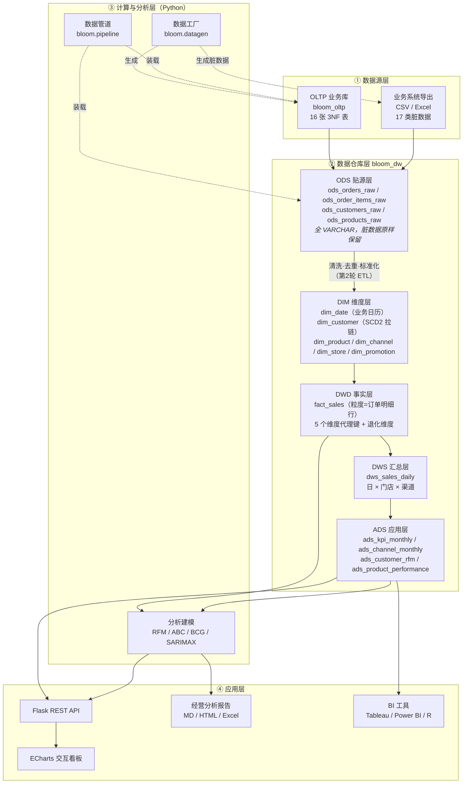
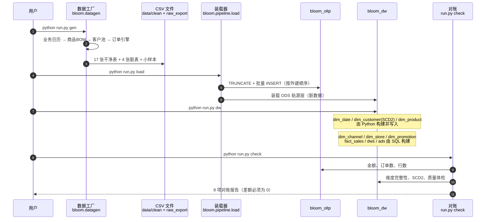
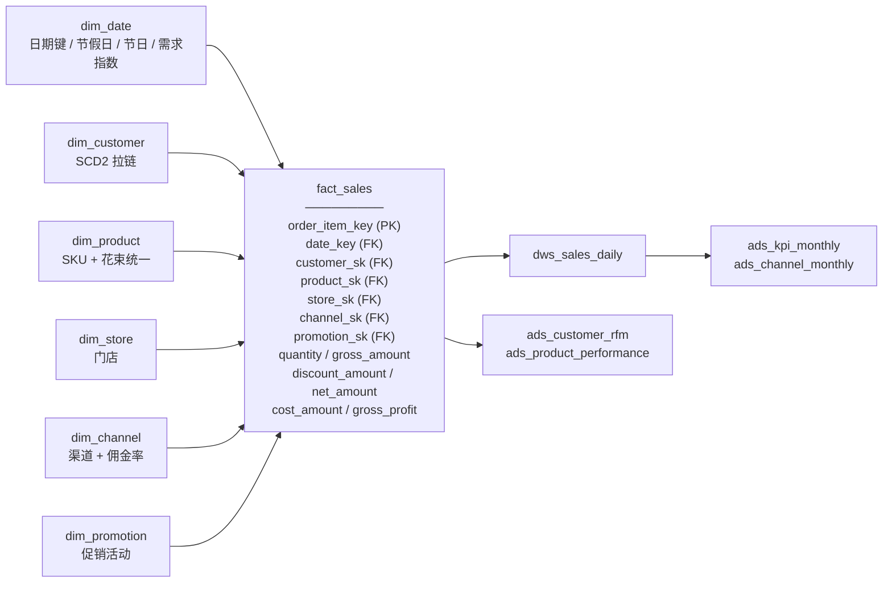
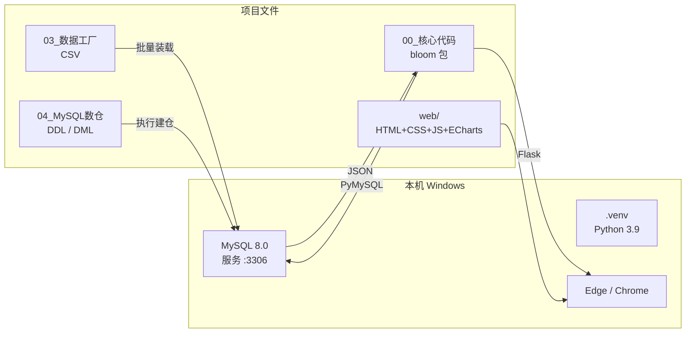

# 架构图

## 一、总体分层架构

---

## 二、数据流时序（一轮完整跑批）

---

## 三、数仓建模（星型模型）

---

## 四、部署与运行视图

---

## 五、关键分层职责对照表

| 层 | 表数量 | 数据特征 | 更新频率 | 典型查询 |
| --- | --- | --- | --- | --- |
| OLTP | 16 | 强一致、行级更新 | 实时 | 下单、改状态、查订单 |
| ODS | 4 | 原样落地、不设约束 | 每日 | 追溯原始值、重跑清洗 |
| DIM | 6 | 缓慢变化、带历史版本 | 每日 | 维度关联、按城市/品类分组 |
| DWD | 1 | 明细事实、只增不改 | 每日 | 多维下钻、用户行为分析 |
| DWS | 1 | 预聚合、粒度固定 | 每日 | 看板趋势、门店对比 |
| ADS | 4 | 宽表、口径固化 | 每日/实时 | 首页 KPI、报告取数 |
