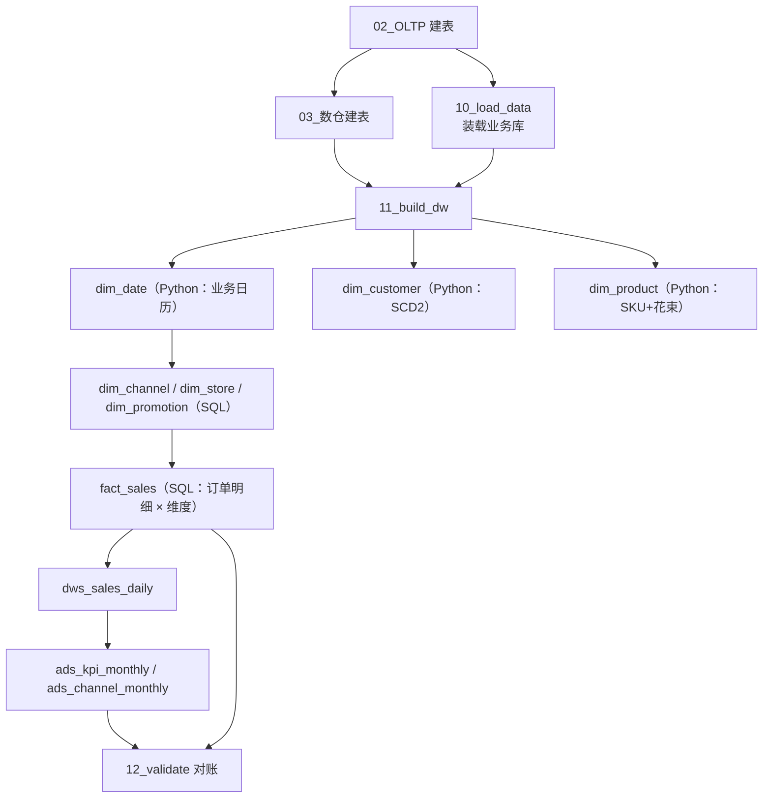

# 数仓分层设计

## 一、为什么要分层

不分层的数仓会变成这样：每个报表自己写一套 SQL、每个口径各自实现、
出了问题无法定位是数据错还是逻辑错。分层解决的是**可维护性**与**口径唯一性**：

| 层 | 解决什么问题 | 本项目的取舍 |
| --- | --- | --- |
| ODS | **可追溯**：原始数据长什么样，永远查得到 | 全字段 `VARCHAR`，脏数据照样进（能进才能洗） |
| DIM/DWD | **口径唯一**：清洗一次，全公司共用 | 维度代理键 + 明细事实，只增不改 |
| DWS | **性能**：把高频聚合下沉，避免重复扫事实表 | 粒度固定为「日 × 门店 × 渠道」 |
| ADS | **易用**：前端零 JOIN，查一张表出图 | 宽表 + 预计算比率，一个接口一张表 |

---

## 二、各层设计明细

### 2.1 ODS 贴源层（4 张）

| 表 | 来源 | 设计要点 |
| --- | --- | --- |
| `ods_orders_raw` | 业务系统导出的订单 CSV | 所有字段 `VARCHAR`；保留 `batch_id`/`load_time` |
| `ods_order_items_raw` | 明细导出 | 同上 |
| `ods_customers_raw` | 客户导出 | 手机号、城市可能含脏值 |
| `ods_products_raw` | 商品导出 | 价格可能是 0 或 99999 |

**为什么全是 VARCHAR？** 如果 ODS 用 `DECIMAL`，那么一条 `payable_amount = -1`
或 `order_time = '2024年5月6日'` 的记录就会导致整批装载失败。
ODS 的职责是"接住数据"，校验和转换是 DWD 的事。

### 2.2 DIM 维度层（6 张）

| 表 | 主键 | 要点 |
| --- | --- | --- |
| `dim_date` | `date_key` (yyyymmdd) | 业务日历：法定假、农历节日、预售节奏、`demand_index` |
| `dim_customer` | `customer_sk` | **SCD2 拉链**：`valid_from/valid_to/is_current/version` |
| `dim_product` | `product_sk` | SKU 与花束统一；`price_band` 由函数 `fn_price_band()` 计算 |
| `dim_channel` | `channel_sk` | 含 `commission_rate`，用于算佣金后净利 |
| `dim_store` | `store_sk` | 面积/人数，用于坪效人效 |
| `dim_promotion` | `promotion_sk` | **含 sk=0「无促销」未知成员**，保证事实表外键非空 |

**SCD2 拉链的实现**

```
customer_id | member_level | valid_from          | valid_to            | is_current | version
C000123     | 银卡会员      | 2024-03-08 00:00:00 | 2025-06-01 00:00:00 | 0          | 1
C000123     | 金卡会员      | 2025-06-01 00:00:00 | NULL                | 1          | 2
```

事实表关联条件固定为 `dc.customer_id = o.customer_id AND dc.is_current = 1`
（当前版本）；如果要还原"下单当时"的等级，改成
`o.order_time BETWEEN dc.valid_from AND IFNULL(dc.valid_to, '9999-12-31')`。
本项目用后者保证历史口径正确。

### 2.3 DWD 事实层（1 张）

**`fact_sales` —— 粒度：订单明细行（一个订单里的一件商品）**

这是整个数仓的原子粒度，所有上层指标都由它聚合而来：

| 字段组 | 字段 | 说明 |
| --- | --- | --- |
| 主键 | `order_item_key` | 代理键（自增） |
| 退化维度 | `item_id`, `order_id`, `order_time` | 保留在事实表里，便于下钻到单据 |
| 外键 | `date_key`, `customer_sk`, `product_sk`, `store_sk`, `channel_sk`, `promotion_sk` | 6 个维度 |
| 度量 | `quantity`, `gross_amount`, `discount_amount`, `freight_amount`, `net_amount`, `cost_amount`, `gross_profit` | 可加性度量 |
| 标记 | `order_status`, `is_refunded`, `is_first_order` | 用于过滤口径（如剔除取消单） |

**度量定义（口径唯一的关键）**

```
gross_amount   = 原价 × 数量
net_amount     = gross_amount - discount_amount     （商品实收，不含运费）
payable        = net_amount + freight_amount        （顾客实付）
gross_profit   = net_amount - cost_amount           （商品毛利，不含履约成本）
```

### 2.4 DWS 汇总层（1 张）

`dws_sales_daily`：粒度「日 × 门店 × 渠道」，预聚合 10 个指标。
选这个粒度的理由：

- 覆盖 90% 的看板查询（趋势、门店对比、渠道对比都要按这三者下钻）；
- 基数可控：1053 天 × 8 门店 × 6 渠道 ≈ 5 万行，比事实表小一个数量级；
- 再细就退化成事实表，再粗就没法下钻。

### 2.5 ADS 应用层（4 张）

| 表 | 粒度 | 服务的场景 |
| --- | --- | --- |
| `ads_kpi_monthly` | 月 | 经营总览、同比环比、目标达成 |
| `ads_channel_monthly` | 月 × 渠道 | 渠道 ROI（含佣金后净利） |
| `ads_customer_rfm` | 客户 | RFM 分层、高价值客户名单（第 3 轮填充） |
| `ads_product_performance` | 商品 | ABC 分类、波士顿矩阵（第 3 轮填充） |

**ADS 的设计原则**：比率类指标（客单价、毛利率）直接算好存下来，
不要让前端或报表工具再算——避免"同一个毛利率，看板 42.1%、报告 42.3%"。

---

## 三、构建顺序与依赖



**为什么维度分两种方式建？**

- `dim_date` 要农历节日与需求指数 → Python 里有结构化配置，比 SQL 里堆 `CASE WHEN` 清晰；
- `dim_customer` 要 SCD2 状态推进 → DataFrame 逐行处理更直观，也好写单测；
- `dim_channel/store/promotion` 结构简单 → `INSERT … SELECT` 一行搞定，减少代码量。

**两种方式各取所长，而不是"什么都用 Python"或"什么都写 SQL"。**

---

## 四、幂等与重跑

所有建仓脚本都是「先清空再插入」，因此可以任意次重跑：

| 操作 | 语句 | 幂等性 |
| --- | --- | --- |
| 建表 | `DROP TABLE IF EXISTS` + `CREATE TABLE` | ✅ |
| 建视图 | `CREATE OR REPLACE VIEW` | ✅ |
| 建函数/过程 | `DROP … IF EXISTS` + `CREATE` | ✅ |
| 装数据 | `TRUNCATE` + `INSERT` | ✅ |
| 存储过程刷新 | 先 `DELETE` 再 `INSERT`，事务包裹 | ✅ |

> 真实生产环境会用「分区覆盖写 + 增量水位线」，个人项目用全量重跑换取简单可靠，
> 这一点在面试时也要讲清楚取舍。

---

## 五、索引与查询优化策略

### 5.1 索引设计

| 场景 | 索引 | 理由 |
| --- | --- | --- |
| 看板按日期范围查 | `idx_fact_date (date_key)` | 时间是最常用的过滤条件 |
| 客户 RFM 聚合 | `idx_fact_customer_cover (customer_sk, order_time, net_amount, order_status)` | **覆盖索引**，索引里就能完成 GROUP BY，不回表 |
| 商品 ABC 聚合 | `idx_fact_product_cover (product_sk, net_amount, quantity, cost_amount)` | 同上 |
| DWS 重建 | `idx_fact_date_store_channel (date_key, store_sk, channel_sk)` | 最左前缀匹配 GROUP BY 顺序 |
| 客服查最近订单 | `idx_order_status_time (status, order_time)` | 状态 + 时间联合，避免全表扫 |

### 5.2 优化手段清单

| 手段 | 在哪里用 | 收益 |
| --- | --- | --- |
| 覆盖索引 | 客户/商品聚合索引 | 免回表，IO 减半 |
| 预聚合（DWS） | 看板趋势查询 | 从扫 30 万行明细变成扫 5 万行汇总 |
| 分区表 | `fact_sales_part` 按年 RANGE 分区 | 历史查询只扫目标分区（partition pruning） |
| 批量写入 | `bulk_insert`（多行 VALUES） | 10 万行从"几分钟"降到"几十秒" |
| 关外键校验 | 装载时 `SET FOREIGN_KEY_CHECKS=0` | 避免逐行校验开销 |
| `ANALYZE TABLE` | 建仓末尾 | 让优化器拿到真实基数，执行计划更准 |

### 5.3 可以现场演示的对比实验

```sql
-- ① 分区裁剪：只扫 2026 年分区
EXPLAIN SELECT COUNT(*) FROM bloom_dw.fact_sales_part WHERE date_key BETWEEN 20260101 AND 20261231;
-- 结果里 partitions 列只显示 p2026

-- ② 覆盖索引：Extra = Using index（不回表）
EXPLAIN SELECT customer_sk, SUM(net_amount) FROM bloom_dw.fact_sales GROUP BY customer_sk;

-- ③ 预聚合 vs 明细：对比两条 SQL 的扫描行数
EXPLAIN SELECT SUM(gmv) FROM bloom_dw.dws_sales_daily WHERE date_key >= 20260101;
EXPLAIN SELECT SUM(net_amount + freight_amount) FROM bloom_dw.fact_sales WHERE date_key >= 20260101;
```

---

## 六、核心指标口径（口径字典，第 2 轮会扩展成完整指标体系）

| 指标 | 英文 | 公式 | 口径说明 |
| --- | --- | --- | --- |
| GMV | `gmv` | `SUM(net_amount + freight_amount)` | 实付金额；**剔除已取消订单** |
| 商品实收 | `item_revenue` | `SUM(net_amount)` | 不含运费 |
| 客单价 | `aov` | `gmv / 订单数` | 分母为去重订单数 |
| 毛利率 | `profit_rate` | `SUM(gross_profit) / SUM(gmv)` | 商品毛利口径，不含履约成本 |
| 折扣率 | `discount_rate` | `SUM(discount_amount) / SUM(gross_amount)` | 含促销 + 券 + 会员折扣 |
| 退款率 | `refund_rate` | `退款金额 / GMV` | 按退款发生时间归属月份 |
| 复购率 | `repurchase_rate` | 二次及以上购买客户数 / 总购买客户数 | 统计周期内 |
| 损耗率 | `waste_rate` | `SUM(waste_amount) / SUM(purchase_amount)` | 生鲜花材专用 |
| 周转天数 | `dio` | 平均库存 / 日均出库成本 | 库存效率 |

> **为什么口径要写进文档？** 面试时被问"你们的 GMV 含不含运费、含不含退款"，
> 能立刻答上来，就是专业度的差别。
