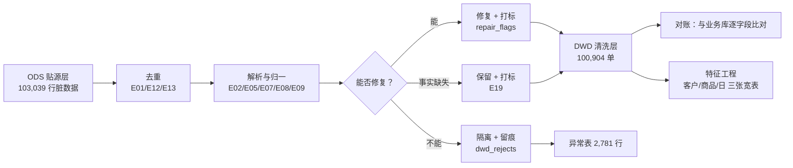

# 06 · ETL 与特征工程说明（第 2 轮 · 2026-11-20）

> 一句话：把**脏的 ODS** 洗成**可信的 DWD**，并证明"一行没丢、一分没多"，
> 再把清洗结果加工成第 3 轮建模直接可用的三张特征表。

---

## 一、本轮产出清单

| 编号 | 文件 | 是什么 |
| --- | --- | --- |
| 00 | `00_说明.md` | 本文件 |
| 01 | `01_DWD与特征表_建表.sql` | 8 张表：4 张清洗层 + 1 张异常隔离表 + 3 张特征表 |
| 02 | `02_清洗规则清单.md` | E01–E19 清洗规则与执行效果（自动生成） |
| 03 | `03_对账报告.md` | 清洗层 vs 业务库的逐项对账（自动生成） |
| 04 | `04_对账结果.json` | 对账结构化结果 |
| 05 | `05_特征字典.md` | 8 张表的字段说明（自动生成） |
| 90 | `90_run_etl.bat` | 一键重跑 |
| — | `etl_run.json` | 本次运行的完整统计（供治理模块读取） |

---

## 二、执行流程



一条命令：

```bash
python run.py etl      # 或双击 90_run_etl.bat
```

---

## 三、清洗哲学：三条原则

| 原则 | 适用 | 例子 | 是否保留数据 |
| --- | --- | --- | --- |
| **能修则修，且留痕** | 格式不规范、别名、维表可回填 | 时间多格式解析、状态别名映射、单价为 0 回填 | ✅ `repair_flags` 记录 |
| **不能修则隔离，且留痕** | 真值已损坏 | 金额勾稽失败、时间越界、数量非正 | ❌ 进 `dwd_rejects`（带原始 JSON） |
| **事实缺失只标记** | 记录本身没错，只是缺一个字段 | 已完成单缺配送时间 | ✅ `repair_flags=E19` |

**为什么不"洗成 100 分"？**
把 `已完成但缺配送时间` 补成"预计送达时间"能让质量分变好看，
但会直接污染"平均履约时长""准时送达率"两个核心指标。
数据治理的第一原则是**不制造假数据**，第二才是好看。

---

## 四、对账结果（本轮的硬证据）

| 校验项 | 结果 |
| --- | --- |
| 订单行数 | 业务库 101,818 ＝ 清洗层 100,904 + 隔离 914 ✅ |
| 只在清洗层出现（凭空多出） | **0** ✅ |
| 金额勾稽 | 差额 227,144.84 ＝ 隔离订单金额 227,144.84，解释差 **0.00** ✅ |
| 下单时间一致性 | 100,904 / 100,904 ✅ |
| 订单状态一致性 | 100,904 / 100,904 ✅ |
| 实付金额一致性 | 100,904 / 100,904 ✅ |
| 送达时间不一致 | 3,025（= E19 标记的"缺配送时间"，事实缺失） |
| 客户编号不一致 | 2,019（= E06 置为 UNKNOWN 的游客订单，事实缺失） |

明细：业务库 116,292 行 → 清洗层 114,425 行，差额 1,867 全部来自
「所属订单被隔离 → 明细连带隔离」（E18），不是丢数。

> 对账的意义：数仓最容易出的问题不是"报错"，而是**悄悄少了 1 万行还没人发现**。
> 有了这套对账，每次跑完都能用一句话回答"这次清洗有没有问题"。

---

## 五、三张特征表（第 3 轮建模的输入）

| 表 | 粒度 | 行数 | 主要特征 | 服务于 |
| --- | --- | ---: | --- | --- |
| `dws_customer_profile` | 客户 | 28,311 | R/F/M、客单价、活跃天数、平均购买间隔、品类/价格带/渠道偏好、节日占比、退款次数、生命周期 | RFM 分群、CLV、流失预警 |
| `dws_product_profile` | 商品 | 56 | 销量、销售额、毛利、毛利率、客户数、复购客户数、节日销量占比、同比增速、ABC 分类 | ABC、波士顿矩阵、选品 |
| `dws_daily_features` | 日 | 1,053 | 订单/客户/件数/GMV/AOV/毛利、节假日与节日标记、需求指数、7/28 天滞后、7/28 日移动平均、去年同期 | 季节分解、SARIMAX 预测 |

**特征设计的三条纪律**：

1. **不泄漏未来**：`lag_7`、`ma_28`、`yoy_gmv` 全部只用当前及历史数据，
   时间序列预测最忌"用未来算出来的特征预测未来"；
2. **口径唯一**：R 的"今天"固定为数据截止日 + 1 天（2026-11-19），
   否则今天跑和明天跑的 RFM 结果会漂移；
3. **可复算**：三张表全部从事实表推导，改一行代码即可全量重算，不存中间态。

---

## 六、这次跑出来的三个真 bug（值得写进简历）

写代码最怕"看起来对"，这三个问题是靠**业务合理性**而不是报错发现的：

### Bug 1：企业客户一个都没生成

- **现象**：`企业客户 GMV 占比 = 0.00%`，但渠道分析里"企业团购"明明有 1,900 多单。
- **根因**：客户池里企业客户排在最后，但分配器从下标 0 开始取，
  把个人客户当企业客户用了；真正建成的企业客户因为从未被激活，写盘时被过滤掉。
- **修复**：分配器从"第一个企业客户的位置"开始取（`ent_start`），并在用尽时兜底复用。
- **修复后**：企业客户 GMV 占比 9.99%，客单价 1,200+ 元，符合 B2B 业务特征。

### Bug 2：准时送达率只有 62.5%

- **现象**：花店同城配送 4 小时承诺，只有 62% 准时，不合常理。
- **根因**："不迟到"的订单延迟时间取了 `[-60, 30)` 分钟区间，
  有 30/90 的概率生成"迟到 1–30 分钟"的记录——凭空制造了 30% 的迟到。
- **修复**：未迟到分支改为 `[-120, 0]`，保证严格早于承诺时间。
- **修复后**：准时送达率 91.25%（迟到率 8.75%，与设定的 8% 迟到概率吻合）。

### Bug 3：库存周转天数 14,917 天

- **现象**：花材 5–15 天货架期，算出来要 40 年才周转一次。
- **根因**：公式写成 `SUM(库存金额) / (SUM(出库成本) / 天数)`，
  分子是全表 43,173 行求和（41 个 SKU × 1053 天），分母是"日均"，
  量纲差了 41 倍还多。正确做法是 `SUM(库存金额) / SUM(出库成本)`（都是三年累计，比值即周转天数）。
- **修复后**：14.60 天，与"生鲜花材一周左右卖完"的业务常识一致。

> 这三个 bug 的共同点：**代码没报错、跑得通、数字也在合理范围之外**。
> 只有拿业务常识去校验（企业客户怎么可能为零？花店怎么可能 40 年周转一次？），
> 才能发现它们。这也是"数据分析"和"跑数"的区别。

---

## 七、怎么验证这一轮做对了

```bash
python run.py etl       # 看"对账完成"那行：金额差 = 隔离金额
type 03_对账报告.md      # 看五个 ✅
python run.py gov       # 看 DWD 得分 > ODS 得分
```

另外可以直接查库：

```sql
-- 清洗后仍带标记的行（应能解释每一条）
SELECT reason_code, COUNT(*) FROM bloom_dw.dwd_rejects GROUP BY reason_code;

-- 修复痕迹（每行改了什么）
SELECT repair_flags, COUNT(*) FROM bloom_dw.dwd_orders_clean
GROUP BY repair_flags ORDER BY 2 DESC LIMIT 10;
```
