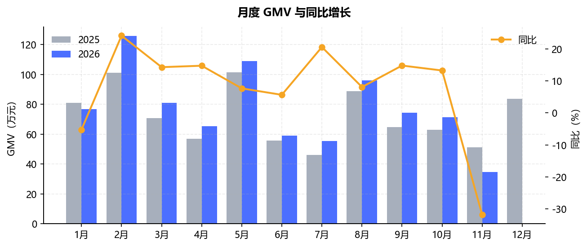
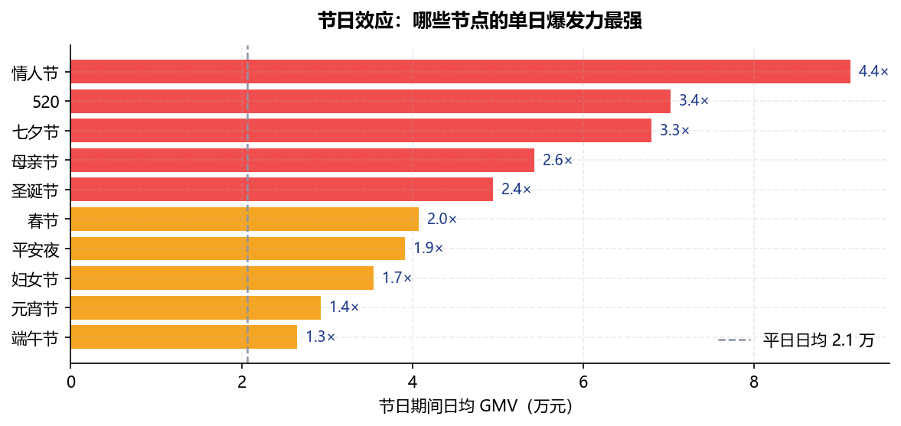

# 经营总览与趋势分析

> 生成时间：2026-11-21 11:07:52｜数据范围：2024-01-01 ~ 2026-11-18｜口径：剔除已取消订单

## 一、核心结论

1. **今年前 10.5 个月 GMV 848.02 万元，同比 +11.6%**，增量 88.47 万元。
2. 订单数 +11.0%，客单价 +0.5%（249 → 250 元）——增长主要来自**客流**。
3. 节日是绝对主场：情人节 期间日均 GMV 是平日的 **4.4 倍**，全年前 10 大节日贡献 55% 的 GMV（按 2025-2026 合计口径）。
4. 毛利率稳定在 61% 左右，说明**折扣没有失控**；真正的利润差异在渠道佣金与库存损耗（见后续章节）。

## 二、同比与量价拆分

| 指标 | 2025 同期 | 2026 同期 | 变化 |
| --- | --- | --- | --- |
| GMV（元） | 7,595,509 | 8,480,216 | +11.65% |
| 订单数 | 30,500 | 33,868 | +11.04% |
| 客单价（元） | 249.03 | 250.39 | +0.54% |
| 成交客户数 | 15,193 | 20,658 | +35.97% |
| 毛利额（元） | 4,652,325 | 5,197,951 | +11.73% |

**量价拆分**（把 GMV 增长拆成「卖得多」和「卖得贵」两部分）：

| 效应 | 金额（元） | 占总增量 | 解释 |
| --- | --- | --- | --- |
| 销量效应 | 838,743 | 94.8% | 订单数变化 × 去年客单价（+3,368 单） |
| 价格效应 | 41,392 | 4.7% | 客单价变化 × 去年订单数（+1.36 元） |
| 交叉项 | 4,571 | 0.5% | 两者同时变化的部分 |
| **合计** | **884,707** | 100% |  |

> 读图：2026 年 2 月（情人节）与 5 月（520+母亲节）是双峰，7 月是全年低谷——备货与人力排班应围绕这两个峰与一个谷来设计。

## 三、节日效应

| 节日 | 天数 | 日均 GMV（元） | 平日倍数 | 客单价（元） |
| ---:, | ---:, | ---:, | ---:, | ---:, |
| 情人节 | 10 | 91,231 | 4.41× | 319 |
| 520 | 9 | 70,162 | 3.39× | 315 |
| 七夕节 | 9 | 68,000 | 3.29× | 304 |
| 母亲节 | 9 | 54,265 | 2.62× | 219 |
| 圣诞节 | 2 | 49,454 | 2.39× | 312 |
| 春节 | 33 | 40,753 | 1.97× | 252 |
| 平安夜 | 4 | 39,154 | 1.89× | 274 |
| 妇女节 | 6 | 35,482 | 1.72× | 233 |
| 元宵节 | 2 | 29,265 | 1.41× | 247 |
| 端午节 | 5 | 26,533 | 1.28× | 266 |

> 读图：红色柱子表示日均 GMV 超过平日 2 倍。
> 情人节/七夕/520 是「量的爆发」，母亲节是「量的稳定高峰」，清明则是「低客单的结构性需求」——
> 三种节日的备货逻辑完全不同：前者要备高价玫瑰，后者要备康乃馨与白菊。

