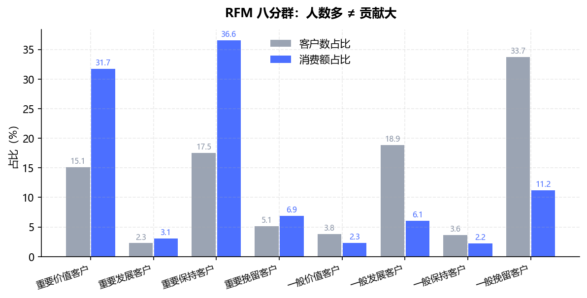
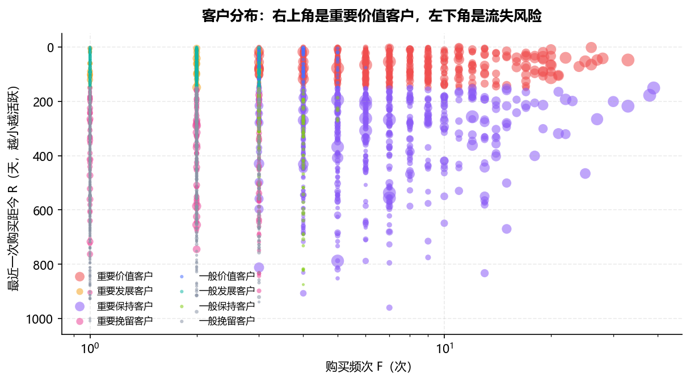

# RFM 用户价值分析

> 生成时间：2026-11-21 11:07:55｜数据范围：2024-01-01 ~ 2026-11-18｜口径：剔除已取消订单

## 一、核心结论

1. **重要价值客户只占 15.1% 的客户，却贡献 31.7% 的消费额**；把「重要保持客户」也算上，**32.6% 的客户贡献了 68.3% 的消费额**——典型二八结构。
2. 「重要发展客户」只有 2.3%，但年化价值最高（平均 CLV 4,646 元）——他们是近期才被识别出来的高潜力客户，要在第一次高消费后立刻做「二次触达」，否则很容易变成「重要挽留」。
3. 「重要保持客户」平均 326 天没来了，但历史客单价高，是最值得做召回的人群。
4. 挽留类客户合计 11,007 人（38.9%），贡献 18.1% 消费额——基数大但价值低，适合低成本触达（短信/券）。
5. **RFM 规则分群与 K-Means 聚类的一致性 ARI = 0.235**（1 为完全一致，0 为随机），说明规则分群与数据自组织的结果方向一致。

## 二、八分群明细

| 分群 | 定义 | 客户数 | 人数占比 | 消费额占比 | 平均R(天) | 平均F(次) | 平均消费(元) | 平均CLV(元) |
| --- | --- | --- | --- | --- | --- | --- | --- | --- |
| 重要价值客户 | R高 F高 M高 | 4,275 | 15.1% | 31.7% | 69 | 7.2 | 1,821 | 1,877 |
| 重要发展客户 | R高 F低 M高 | 640 | 2.3% | 3.1% | 70 | 1.9 | 1,175 | 4,646 |
| 重要保持客户 | R低 F高 M高 | 4,951 | 17.5% | 36.6% | 326 | 6.8 | 1,813 | 1,501 |
| 重要挽留客户 | R低 F低 M高 | 1,458 | 5.1% | 6.9% | 400 | 2.1 | 1,162 | 1,645 |
| 一般价值客户 | R高 F高 M低 | 1,070 | 3.8% | 2.3% | 71 | 3.4 | 524 | 1,059 |
| 一般发展客户 | R高 F低 M低 | 5,340 | 18.9% | 6.1% | 71 | 1.4 | 279 | 1,283 |
| 一般保持客户 | R低 F高 M低 | 1,028 | 3.6% | 2.2% | 300 | 3.5 | 530 | 662 |
| 一般挽留客户 | R低 F低 M低 | 9,549 | 33.7% | 11.2% | 378 | 1.5 | 287 | 482 |

## 三、K-Means 交叉验证

对 R/F/M 标准化后做 K-Means（k=4），与 8 分群的交叉分布如下（ARI = **0.235**）：

| 分群 | 簇0 | 簇1 | 簇2 | 簇3 | 合计 |
| ---: | ---: | ---: | ---: | ---: | ---: |
| 一般价值客户 | 896 | 174 | 0 | 0 | 1,070 |
| 一般保持客户 | 653 | 129 | 246 | 0 | 1,028 |
| 一般发展客户 | 637 | 4,703 | 0 | 0 | 5,340 |
| 一般挽留客户 | 673 | 5,103 | 3,773 | 0 | 9,549 |
| 重要价值客户 | 3,190 | 0 | 0 | 1,085 | 4,275 |
| 重要保持客户 | 2,973 | 0 | 874 | 1,104 | 4,951 |
| 重要发展客户 | 640 | 0 | 0 | 0 | 640 |
| 重要挽留客户 | 829 | 0 | 629 | 0 | 1,458 |

> 读表：聚类把客户分成 4 组「数据形态」，规则分群分成 8 组「运营语义」，
> 两者高度重叠说明：**R/F/M 三维确实能区分客户层次**，不是人为硬切。
> 运营落地时用 8 分群（可解释、可命名），做模型时用聚类（可扩展）。

## 四、两张图看懂客户结构

> 读图：灰色是人数占比，蓝色是消费额占比。两者差距越大，说明该群体越「值钱」。

> 读图：横轴是频次（对数刻度），纵轴是最近购买天数（越小越活跃）。
> 点越大表示消费额越高。理想客户在右上角（高频 + 近期），
> 左下角是「曾经活跃、现在沉默」的召回重点。

## 五、分群运营动作建议

| 分群 | 运营目标 | 具体动作 | 预算优先级 |
| --- | --- | --- | --- |
| 重要价值客户 | 维系 + 提客单 | 专属花艺顾问、生日/纪念日提醒、新品优先体验 | 最高 |
| 重要发展客户 | 提频次 | 订阅制周花、满 3 次送保养、企业场景推荐 | 高 |
| 重要保持客户 | 召回 | 定向唤醒券（限 30 天）、老客回归礼、电话回访 | 最高 |
| 重要挽留客户 | 判断流失原因 | 低折扣挽回（避免伤价）、问卷调研 | 中 |
| 一般价值客户 | 提客单 | 搭售推荐（花材 + 花瓶）、节日前预热 | 中 |
| 一般发展客户 | 转首复购 | 首单后 7 天发二次券、晒单返券 | 高 |
| 一般保持/挽留 | 低成本触达 | 节点短信、公众号内容触达，不投人工 | 低 |

