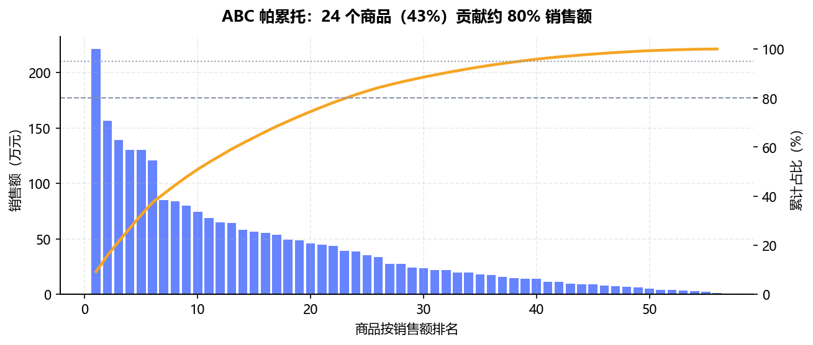
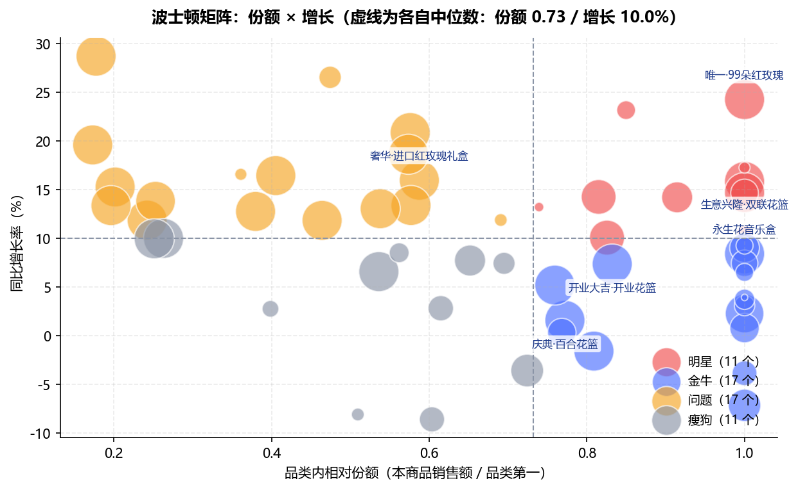

# 商品结构与波士顿矩阵

> 生成时间：2026-11-21 11:07:55｜数据范围：2024-01-01 ~ 2026-11-18｜口径：剔除已取消订单

## 一、核心结论

1. **24 个商品（占 43%）贡献了 80% 的销售额**，其中 TOP1「唯一·99朵红玫瑰」单品就占 9.2%。
2. 波士顿矩阵：明星 11 个、金牛 17 个、问题 17 个、瘦狗 11 个。金牛贡献 29% 的毛利，是现金来源。
3. **6 个商品负增长**，其中包含部分 A 类商品——这类「高份额、负增长」的组合正是需要警惕的衰退信号。
4. 花束（BUNDLE）贡献 93.5% 的销售额，但花束单价高、复购低；花材（SKU）单价低、复购高，是「高频带低频」的引流品。

## 二、ABC 分类结果

| 类别 | 商品数 | 销售额占比 | 毛利占比 | 管理策略 |
| --- | --- | --- | --- | --- |
| A 类（累计 0-80%） | 24 | 79.8% | 80.9% | 重点保障供应、优先陈列、控损耗 |
| B 类（80-95%） | 15 | 14.9% | 14.0% | 常规补货、组合搭售 |
| C 类（95%+） | 17 | 5.3% | 5.0% | 清库存、减少采购、评估下架 |

## 三、波士顿矩阵

| 象限 | 商品数 | 销售额占比 | 毛利占比 | 策略 |
| --- | --- | --- | --- | --- |
| 问题 | 17 | 34.7% | 33.9% | 选择性投入、测试爆款 |
| 金牛 | 17 | 29.2% | 28.9% | 维持、提毛利、控成本 |
| 明星 | 11 | 23.9% | 25.2% | 加大投入、保供应 |
| 瘦狗 | 11 | 12.2% | 12.0% | 收缩、清库存或下架 |

> 读图：横轴是品类内相对份额（虚线为全品中位数 0.73），纵轴是同比增长率（虚线为中位数 10.0%）。
> 气泡越大销售额越高。理想位置是右上角（明星），最需要警惕的是「右下角」——高份额但负增长，说明正在被替代。

## 四、TOP10 商品明细

| 排名 | 商品 | 类型 | 品类 | 销量 | 销售额（元） | 毛利率 | 同比 | ABC | BCG |
| ---: | ---: | ---: | ---: | ---: | ---: | ---: | ---: | ---: | ---: |
| 1 | 唯一·99朵红玫瑰 | BUNDLE | 爱情告白 | 1914 | 2,212,455 | 69.39% | 24.25% | A | 明星 |
| 2 | 生意兴隆·双联花篮 | BUNDLE | 开业庆典 | 3872 | 1,564,321 | 63.49% | 15.83% | A | 明星 |
| 3 | 永生花音乐盒 | BUNDLE | 日常悦己 | 4049 | 1,390,313 | 68.49% | 8.41% | A | 金牛 |
| 4 | 开业大吉·开业花篮 | BUNDLE | 开业庆典 | 3773 | 1,301,761 | 60.73% | 7.36% | A | 金牛 |
| 5 | 奢华·进口红玫瑰礼盒 | BUNDLE | 爱情告白 | 1850 | 1,299,903 | 64.63% | 15.96% | A | 问题 |
| 6 | 庆典·百合花篮 | BUNDLE | 开业庆典 | 3831 | 1,207,927 | 59.25% | 1.58% | A | 金牛 |
| 7 | 母亲的爱·康乃馨礼盒 | BUNDLE | 感恩祝福 | 2902 | 850,452 | 68.57% | 14.70% | A | 明星 |
| 8 | 心动·33朵红玫瑰 | BUNDLE | 爱情告白 | 1965 | 840,236 | 65.60% | 12.76% | A | 问题 |
| 9 | 郁见你·郁金香花束 | BUNDLE | 日常悦己 | 3904 | 800,708 | 61.04% | 20.86% | A | 问题 |
| 10 | 浪漫满屋·粉绣球 | BUNDLE | 日常悦己 | 4018 | 745,446 | 59.41% | 6.58% | A | 瘦狗 |

## 五、选品与定价建议

1. **A 类 + 明星**：保障供应优先级最高，宁可多备 10% 也不能断货；
2. **A 类 + 金牛**：是利润基本盘，不要轻易打折，用搭售提升客单；
3. **问题类**：小批量测试 + 快速迭代，跑通再放量（避免一次性压货）；
4. **瘦狗类**：优先清库存，SKU 数量从 56 个精简到 40 个左右，减少长尾采购与损耗。

