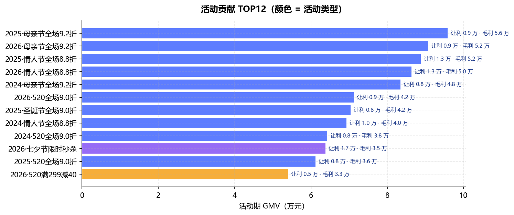
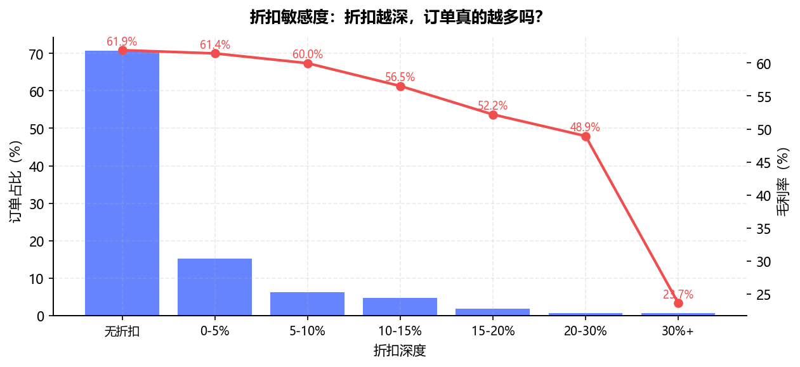

# 促销效果与折扣敏感度

> 生成时间：2026-11-21 11:07:58｜数据范围：2024-01-01 ~ 2026-11-18｜口径：剔除已取消订单

## 一、核心结论

1. 全量订单中 **8.0% 的订单命中了促销活动**，活动订单毛利率 59.27%，非活动订单 61.50%，相差 -2.23pp。
2. 让利效率最高的是「2025年9月会员日」（每让 1 元换回 11.7 元毛利），最低的是「2025·七夕节限时秒杀」（2.0 元）——**同样的预算，活动设计差异能带来数倍效率差**。
3. 折扣越深、毛利率越低：无折扣订单毛利率 61.93%，20-30% 折扣段降到 48.94%。
4. 但**折扣并没有换来等比例的订单量**：20-30% 深度折扣的订单占比只有 0.7%，说明「深折拉新」这条路径在本店并不成立。

## 二、活动让利效率 TOP

| 活动 | 类型 | 节日 | 订单数 | GMV（元） | 让利（元） | 毛利（元） | 毛利率 | 让利效率 |
| ---: | ---: | ---: | ---: | ---: | ---: | ---: | ---: | ---: |
| 2025·母亲节全场9.2折 | 折扣 | 母亲节 | 432 | 95,827 | 9,360 | 56,256 | 58.71% | 6.0 |
| 2026·母亲节全场9.2折 | 折扣 | 母亲节 | 452 | 90,655 | 9,244 | 52,281 | 57.67% | 5.7 |
| 2025·情人节全场8.8折 | 折扣 | 情人节 | 295 | 88,782 | 12,953 | 51,762 | 58.30% | 4.0 |
| 2026·情人节全场8.8折 | 折扣 | 情人节 | 305 | 86,372 | 12,882 | 49,911 | 57.79% | 3.9 |
| 2024·母亲节全场9.2折 | 折扣 | 母亲节 | 403 | 83,450 | 8,105 | 48,324 | 57.91% | 6.0 |
| 2026·520全场9.0折 | 折扣 | 520 | 241 | 71,231 | 8,868 | 42,049 | 59.03% | 4.7 |
| 2025·圣诞节全场9.0折 | 折扣 | 圣诞节 | 221 | 70,366 | 8,461 | 42,104 | 59.84% | 5.0 |
| 2024·情人节全场8.8折 | 折扣 | 情人节 | 254 | 69,312 | 10,027 | 39,964 | 57.66% | 4.0 |
| 2024·520全场9.0折 | 折扣 | 520 | 208 | 64,217 | 7,953 | 38,363 | 59.74% | 4.8 |
| 2026·七夕节限时秒杀 | 秒杀 | 七夕节 | 223 | 63,773 | 16,689 | 34,815 | 54.59% | 2.1 |

## 三、折扣敏感度

| 折扣深度 | 订单占比 | 客单价（元） | 毛利率 | 平均件数 |
| ---: | ---: | ---: | ---: | ---: |
| 无折扣 | 70.70% | 255 | 61.93% | 2.27 |
| 0-5% | 15.18% | 256 | 61.44% | 2.22 |
| 5-10% | 6.19% | 276 | 59.96% | 1.97 |
| 10-15% | 4.74% | 214 | 56.51% | 2.20 |
| 15-20% | 1.82% | 181 | 52.20% | 2.86 |
| 20-30% | 0.72% | 123 | 48.94% | 4.55 |
| 30%+ | 0.65% | 24 | 23.66% | 2.79 |

> 读图：柱状是各折扣区间的订单占比，红线是毛利率。
> 如果「深折扣 → 订单暴增」，柱子应该向右显著变高；实际并没有，
> 说明本店客户对「有没有折扣」不敏感，更在意「节日要有花」。

## 四、口径边界（很重要）

本报告**不提供「活动增量 ROI」**，原因：
1. 活动期与节日高度重合，节日本身带来 3~4 倍自然增长，无法拆分；
2. 没有对照组（A/B 实验或同城市对照门店），观测数据无法识别因果。

因此这里给的是**「让利效率」**（活动毛利 / 让利金额），它能回答「同样一笔折扣预算，哪个活动更划算」，但不能回答「如果不打折会怎样」。
要做严格的促销归因，需要：**门店级 A/B 实验** 或 **合成控制法（Synthetic Control）**。

## 五、优化建议

1. **减少深折**：20% 以上折扣的订单占比低、毛利损失大，建议改用「满减」提高客单；
2. **复制高效活动**：让利效率高的活动集中在节日限定款，可固化为年货节模板；
3. **券要定向**：把券发给「重要保持/重要挽留」客户（见 RFM 章节），而不是全量撒券——后者只会补贴本来就要买的人。

