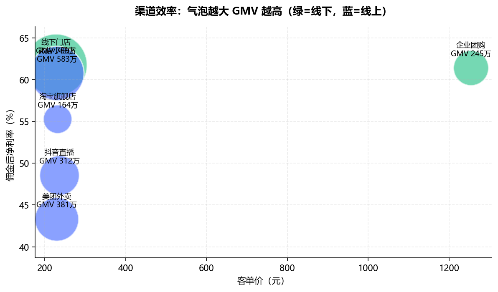
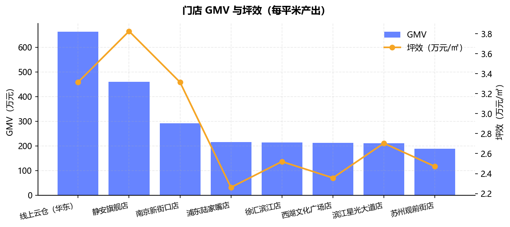

# 渠道与门店效率

> 生成时间：2026-11-21 11:08:00｜数据范围：2024-01-01 ~ 2026-11-18｜口径：剔除已取消订单

## 一、核心结论

1. GMV 第一是「线下门店」（769 万，占 31.3%），但**佣金后净利率最高的是「线下门店」（61.8%）**。
2. 线上渠道贡献 58.7% 的 GMV，但全渠道一年被平台抽走佣金 **117.7 万元**——相当于 4.8% 的 GMV。
3. 净利率最低的是「美团外卖」（43.3%），主要被 18% 的平台佣金吃掉。
4. 门店之间坪效差异明显：最高 3.83 万/㎡，最低 2.26 万/㎡，差 1.7 倍。

## 二、渠道效率明细

| 渠道 | 类型 | 订单数 | GMV（元） | GMV占比 | 客单价 | 佣金率 | 佣金（元） | 佣金后毛利（元） | 净利率 |
| ---: | ---: | ---: | ---: | ---: | ---: | ---: | ---: | ---: | ---: |
| 线下门店 | 线下 | 33,758 | 7,689,201 | 31.3% | 228 | 0.0% | 0 | 4,748,668 | 61.8% |
| 微信小程序 | 线上 | 25,363 | 5,830,992 | 23.8% | 230 | 0.6% | 34,986 | 3,542,665 | 60.8% |
| 美团外卖 | 线上 | 16,583 | 3,808,867 | 15.5% | 230 | 18.0% | 685,596 | 1,648,970 | 43.3% |
| 抖音直播 | 线上 | 13,220 | 3,124,505 | 12.7% | 236 | 12.0% | 374,941 | 1,516,492 | 48.5% |
| 企业团购 | 线下 | 1,955 | 2,452,256 | 10.0% | 1,254 | 0.0% | 0 | 1,505,909 | 61.4% |
| 淘宝旗舰店 | 线上 | 7,054 | 1,635,253 | 6.7% | 232 | 5.0% | 81,763 | 904,029 | 55.3% |

> 读图：右上角是「高客单 + 高净利」的理想渠道；
> 左下角是「低客单 + 低净利」的待优化渠道；气泡大小代表 GMV 体量。

## 三、门店效率

| 门店 | 城市 | 订单数 | GMV（元） | 面积（㎡） | 坪效（元/㎡） | 人效（元/人） |
| ---: | ---: | ---: | ---: | ---: | ---: | ---: |
| 线上云仓（华东） | 上海市 | 28,040 | 6,632,336 | 200 | 33,162 | 1,326,467 |
| 静安旗舰店 | 上海市 | 11,442 | 4,591,127 | 120 | 38,259 | 510,125 |
| 南京新街口店 | 南京市 | 12,664 | 2,917,541 | 88 | 33,154 | 416,792 |
| 浦东陆家嘴店 | 上海市 | 9,457 | 2,148,818 | 95 | 22,619 | 268,602 |
| 徐汇滨江店 | 上海市 | 9,415 | 2,142,259 | 85 | 25,203 | 306,037 |
| 西湖文化广场店 | 杭州市 | 9,300 | 2,121,156 | 90 | 23,568 | 303,022 |
| 滨江星光大道店 | 杭州市 | 9,276 | 2,109,191 | 78 | 27,041 | 351,532 |
| 苏州观前街店 | 苏州市 | 8,339 | 1,878,647 | 76 | 24,719 | 313,108 |

> 读图：柱子是 GMV，折线是坪效。线上云仓面积大、坪效低是正常的（它承担发货功能），
> 真正要对比的是同城门店之间的差距。

## 四、渠道策略建议

1. **把美团当「流量入口」而不是「利润中心」**：18% 佣金下净利率最低，适合做新客首单，但要引导加企微/小程序做二次复购；
2. **抖音做内容种草 + 到店自提**：自提可省配送成本，且自提客户的复购率通常高于纯外卖客户；
3. **小程序是利润池**：佣金几乎为零，应把高价值客户（RFM 重要价值/重要保持）沉淀到私域；
4. **企业团购客单价最高**，但订单量少，需要专门的 B 端销售动作（年节礼品、开业花篮）。

