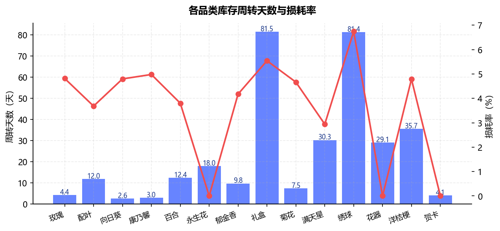

# 库存与损耗分析

> 生成时间：2026-11-21 11:08:00｜数据范围：2024-01-01 ~ 2026-11-18｜口径：剔除已取消订单

## 一、核心结论

1. 全品类采购 721.72 万元，损耗 **30.20 万元（4.18%）**。
2. 生鲜花材中周转最慢的是「绣球」，81.4 天才周转一次，占用库存资金约 1.67 万元（非生鲜类如礼盒/花器周转天数天然偏长，不参与这项排名）。
3. **「绣球」的周转天数是货架期的 13.6 倍**——货还没卖掉就先坏了，这是结构性损耗，不是偶发损耗。
4. 损耗率最高的是「绣球」（6.74%），是平均水平的 1.6 倍。
5. 有 10 个 C 类商品销量垫底，长尾 SKU 是采购分散与损耗的主要来源。

## 二、品类周转与损耗

| 品类 | SKU数 | 出库量 | 平均库存（元） | 周转天数 | 货架期(天) | 周转/货架期 | 损耗率 | 损耗金额（元） |
| ---: | ---: | ---: | ---: | ---: | ---: | ---: | ---: | ---: |
| 玫瑰 | 6 | 571,217 | 8,923 | 4.4 | 6 | 0.7× | 4.82% | 108,644 |
| 配叶 | 4 | 107,627 | 7,924 | 12.0 | 16 | 0.8× | 3.68% | 26,627 |
| 向日葵 | 1 | 130,544 | 1,639 | 2.6 | 8 | 0.3× | 4.80% | 32,835 |
| 康乃馨 | 3 | 343,384 | 1,771 | 3.0 | 12 | 0.3× | 4.98% | 32,394 |
| 百合 | 3 | 83,531 | 6,928 | 12.4 | 10 | 1.2× | 3.80% | 23,248 |
| 永生花 | 2 | 5,960 | 7,887 | 18.0 | — | — | 0.00% | 0 |
| 郁金香 | 3 | 97,982 | 3,815 | 9.8 | 7 | 1.4× | 4.18% | 17,900 |
| 礼盒 | 3 | 8,463 | 23,903 | 81.5 | — | — | 5.54% | 18,282 |
| 菊花 | 3 | 100,465 | 2,055 | 7.5 | 13 | 0.6× | 4.67% | 14,222 |
| 满天星 | 2 | 21,690 | 7,538 | 30.3 | 10 | 3.0× | 2.94% | 7,904 |
| 绣球 | 3 | 12,015 | 16,725 | 81.4 | 6 | 13.6× | 6.74% | 15,538 |
| 花器 | 3 | 14,340 | 4,110 | 29.1 | — | — | 0.00% | 0 |
| 洋桔梗 | 3 | 28,259 | 2,918 | 35.7 | 9 | 4.0× | 4.79% | 4,400 |
| 贺卡 | 2 | 30,443 | 248 | 4.1 | — | — | 0.00% | 0 |

> 读图：柱子是周转天数（越低越好），红线是损耗率。
> 理想位置是「柱子矮 + 红线低」——周转快且损耗小。
> 若某品类柱子高、红线也高，说明既压资金又烂货，是重点整改对象。

## 三、滞销商品 TOP10（C 类）

| 商品 | 品类 | 销量 | 销售额（元） | 毛利率 | 建议 |
| ---: | ---: | ---: | ---: | ---: | ---: |
| 玻璃花瓶 | 花器 | 257 | 9,478 | 67.46% | 观察 |
| 追思·白菊花束 | 祭扫追思 | 429 | 79,066 | 66.90% | 观察 |
| 缅怀·黄白菊 | 祭扫追思 | 480 | 93,044 | 64.92% | 观察 |
| 德芙心形礼盒 | 礼盒 | 511 | 33,230 | 56.94% | 观察 |
| 圣诞·圣诞花环 | 节日限定 | 643 | 142,379 | 58.68% | 观察 |
| 中秋·花好月圆礼盒 | 节日限定 | 647 | 111,903 | 57.21% | 观察 |
| 费列罗巧克力礼盒 | 礼盒 | 993 | 92,015 | 51.44% | 观察 |
| 粉绣球 | 绣球 | 3700 | 138,017 | 51.75% | 观察 |
| 红郁金香 | 郁金香 | 3809 | 37,210 | 57.01% | 观察 |
| 立体贺卡 | 贺卡 | 4586 | 53,441 | 69.96% | 观察 |

## 四、库存优化建议

1. **按周订货 + 预售制**：节日款提前 7 天开预售，按订单采购，把「备货风险」转移给需求侧；
2. **安全库存分级**：A 类商品（销售额前 80%）保持 2 天安全库存，C 类降到 0.5 天并允许缺货；
3. **临期花材做二次加工**：将 3 天内到期花材转为「盲盒花束」「干花材料」，把损耗变成 GMV；
4. **精简 SKU**：56 个在售商品中，17 个 C 类只贡献 5% 销售额，建议砍到 40 个以内，减少采购复杂度与冷库占用。

