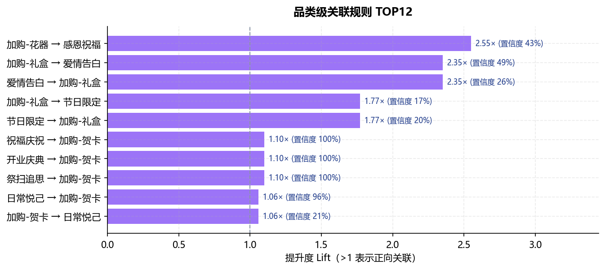

# 关联规则分析（Apriori）

> 生成时间：2026-11-21 11:08:04｜数据范围：2024-01-01 ~ 2026-11-18｜口径：剔除已取消订单

## 一、核心结论

1. 共分析 13,436 个「多件订单」篮子（只统计 ≥2 件商品的订单，单件订单无法产生关联）。
2. 挖掘出品类级规则 10 条、商品级规则 21 条（支持度 ≥0.6%、置信度 ≥8%、提升度 ≥1.05）。
3. 最强关联：**「加购-花器」→「感恩祝福」**，买前者的人有 43.2% 也买了后者，提升度 2.55（是随机情况的 2.55 倍）。
4. 商品层面最强搭配：**「开业大吉·开业花篮」→「手写祝福卡」**，提升度 1.20，可作为套餐组合直接上线。

## 二、算法是怎么跑出来的

```
Apriori：频繁项集的子集必然频繁 → 逐层剪枝
  1. 扫描全部订单，统计单项出现次数 → 保留 ≥ min_support 的 1 项集
  2. 由频繁 1 项集两两组合成候选 2 项集
  3. 只统计「在订单里真实出现」的候选（而不是拿候选去扫全表）
  4. 计算 support / confidence / lift，过滤掉 lift ≤ 1 的规则
```

本次参数：min_support = 0.60%，min_confidence = 8%，max_len = 2。

## 三、品类级规则（可直接指导陈列/套餐）

| 前项（买这个） | 后项（也买） | 共现订单 | 支持度 | 置信度 | 提升度 |
| ---: | ---: | ---: | ---: | ---: | ---: |
| 加购-花器 | 感恩祝福 | 111 | 0.83% | 43.2% | 2.55× |
| 加购-礼盒 | 爱情告白 | 736 | 5.48% | 48.9% | 2.35× |
| 爱情告白 | 加购-礼盒 | 736 | 5.48% | 26.3% | 2.35× |
| 加购-礼盒 | 节日限定 | 254 | 1.89% | 16.9% | 1.77× |
| 节日限定 | 加购-礼盒 | 254 | 1.89% | 19.8% | 1.77× |
| 祝福庆祝 | 加购-贺卡 | 790 | 5.88% | 100.0% | 1.10× |
| 开业庆典 | 加购-贺卡 | 528 | 3.93% | 100.0% | 1.10× |
| 祭扫追思 | 加购-贺卡 | 256 | 1.91% | 100.0% | 1.10× |
| 日常悦己 | 加购-贺卡 | 2,500 | 18.61% | 95.8% | 1.06× |
| 加购-贺卡 | 日常悦己 | 2,500 | 18.61% | 20.5% | 1.06× |



> 读图：条形越长表示关联越强（提升度越高）。
> 提升度 2.0 意味着「买 A 的人买 B 的概率，是普通顾客的 2 倍」。

## 四、商品级规则 TOP10

| 前项 | 后项 | 共现订单 | 支持度 | 置信度 | 提升度 |
| ---: | ---: | ---: | ---: | ---: | ---: |
| 开业大吉·开业花篮 | 手写祝福卡 | 126 | 0.94% | 67.7% | 1.20× |
| 郁见你·郁金香花束 | 立体贺卡 | 162 | 1.21% | 40.2% | 1.18× |
| 庆典·百合花篮 | 手写祝福卡 | 117 | 0.87% | 65.7% | 1.16× |
| 乔迁之喜·绣球花礼 | 手写祝福卡 | 102 | 0.76% | 65.4% | 1.16× |
| 追思·白菊花束 | 手写祝福卡 | 90 | 0.67% | 65.2% | 1.15× |
| 办公桌小花·向日葵 | 手写祝福卡 | 286 | 2.13% | 64.6% | 1.14× |
| 粉玫瑰·艾莎 | 立体贺卡 | 115 | 0.86% | 39.0% | 1.14× |
| 永生花音乐盒 | 立体贺卡 | 156 | 1.16% | 38.4% | 1.13× |
| 前程似锦·混搭花束 | 手写祝福卡 | 104 | 0.77% | 63.8% | 1.13× |
| 感恩·康乃馨花束 | 手写祝福卡 | 248 | 1.85% | 63.3% | 1.12× |

## 五、怎么用这些规则

1. **套餐化**：把高提升度的组合做成「固定套餐」，比单买便宜 5%，既提客单又降拣货复杂度；
2. **加购推荐**：在花束详情页推荐关联商品（如巧克力/贺卡），这是最自然的加购位；
3. **陈列联动**：线下把关联商品摆在一起（花束区旁边放礼盒），减少客户寻找成本；
4. **注意边界**：关联规则只说明「相关」，不说明「因果」——客户买巧克力可能只是因为都要送人，不是因为花「带动」了巧克力。验证因果要靠 A/B 实验。

