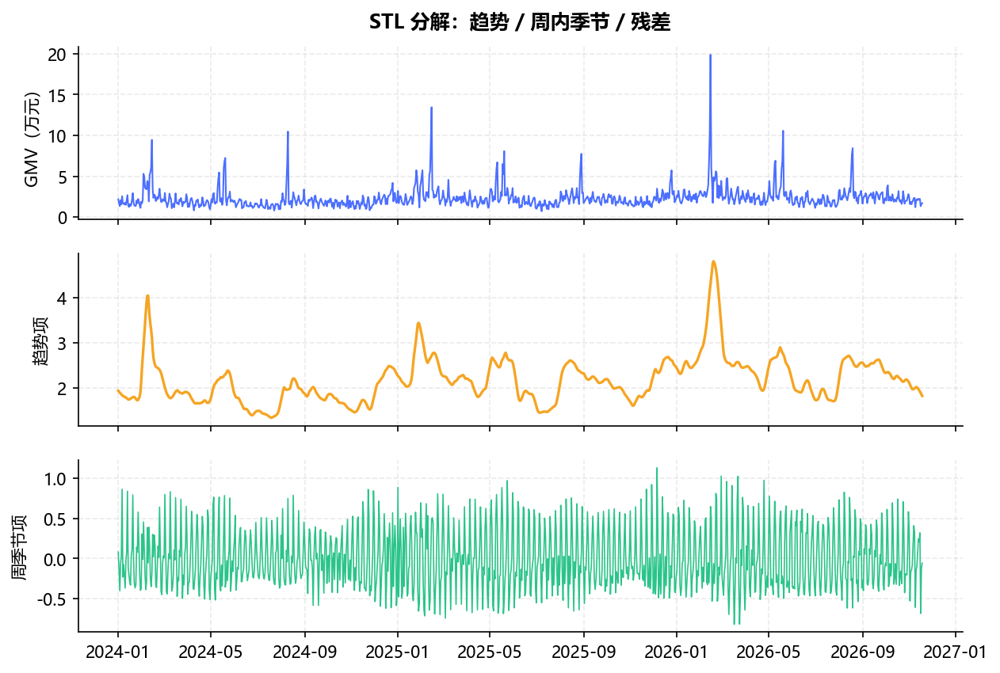
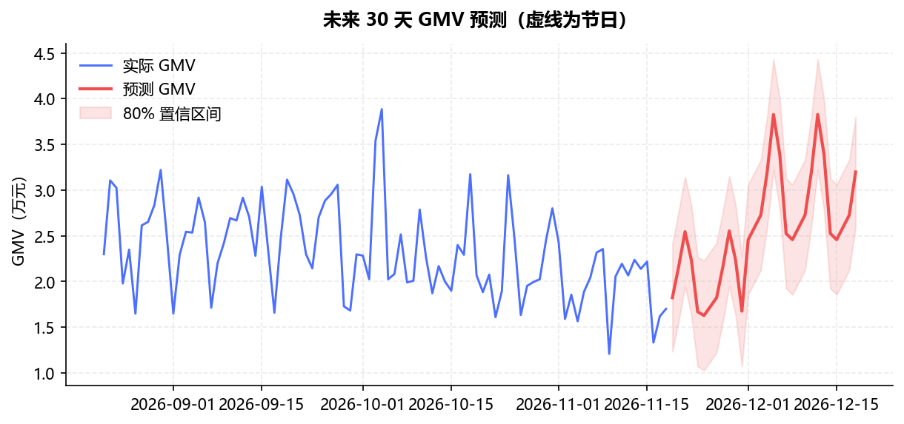

# 销售预测（STL + SARIMAX）

> 生成时间：2026-11-21 11:08:05｜数据范围：2024-01-01 ~ 2026-11-18｜口径：剔除已取消订单

## 一、核心结论

1. 回测（最后 30 天留出）：**MAPE 10.11%**，RMSE 2,406 元——平均误差在个位数百分比，可用于备货参考。
2. 周内效应：周末日均 GMV 是工作日的 **1.33 倍**；节日日均是平日的 **1.68 倍**——后者才是模型最需要的外生变量。
3. 未来 30 天预测合计 **76.65 万元**，峰值出现在 2026-12-12（周末），预计 3.83 万元。
4. 90% 置信区间宽度平均 ±6,003 元，节日附近区间更宽——不确定性本来就集中在脉冲日，这是符合直觉的。

## 二、STL 分解看到了什么

> 读图：第一行是原始序列（能看到情人节/520 的尖峰），
> 第二行是趋势项（稳定上升，年增长约 12%），第三行是周内季节项（周末高、周二低）。
> **趋势项是用来判断「生意是否在变好」的**，比看月度 GMV 更可靠——
> 因为它把节日脉冲剔除了。

## 三、预测结果

| 日期 | 星期 | 节日 | 预测 GMV（元） | 区间下界 | 区间上界 |
| ---: | ---: | ---: | ---: | ---: | ---: |
| 2026-11-19 | 周四 | — | 18,228 | 12,349 | 24,107 |
| 2026-11-20 | 周五 | — | 21,653 | 15,672 | 27,634 |
| 2026-11-21 | 周六 | — | 25,451 | 19,463 | 31,439 |
| 2026-11-22 | 周日 | — | 22,358 | 16,368 | 28,347 |
| 2026-11-23 | 周一 | — | 16,691 | 10,701 | 22,682 |
| 2026-11-24 | 周二 | — | 16,279 | 10,287 | 22,271 |
| 2026-11-25 | 周三 | — | 17,248 | 11,255 | 23,241 |
| 2026-11-26 | 周四 | — | 18,230 | 12,233 | 24,228 |
| 2026-11-27 | 周五 | — | 21,649 | 15,650 | 27,649 |
| 2026-11-28 | 周六 | — | 25,527 | 19,526 | 31,528 |
| 2026-11-29 | 周日 | — | 22,359 | 16,357 | 28,361 |
| 2026-11-30 | 周一 | — | 16,757 | 10,753 | 22,760 |
| 2026-12-01 | 周二 | — | 24,579 | 18,574 | 30,584 |
| 2026-12-02 | 周三 | — | 25,925 | 19,919 | 31,931 |

## 四、模型与假设

| 项目 | 内容 |
| --- | --- |
| 模型 | SARIMAX(1,1,1)(1,0,1,7) + 外生变量 |
| 外生变量 | 是否周末、是否法定节假日、是否营销节日、需求指数 |
| 训练集 | 2024-01-01 ~ 2026-10-19（1,023 天） |
| 测试集 | 最后 30 天（留出法） |
| 精度 | MAPE 10.11%、RMSE 2,406 元 |

**为什么不做更复杂的模型（Prophet/LSTM）？**
1. 数据只有 1,000 天出头，深度模型容易过拟合；
2. SARIMAX 的**可解释性**更强：每个外生变量的系数都能解释业务含义；
3. 业务真正需要的不是「多准」，而是「知道下周情人节要备多少货」——
   一个 MAPE 8% 且能解释的模型，比 MAPE 5% 的黑箱更有用。

## 五、备货建议

1. 按预测峰值 3.83 万元 的 1.15 倍备货，宁可节后打折也不要断货（断货损失的是客户信任）；
2. 情人节前 5 天开始加量，别等到前一天——花材需要养水时间；
3. 预测区间上界可用于「激进备货」决策，下界用于「保守排班」。

