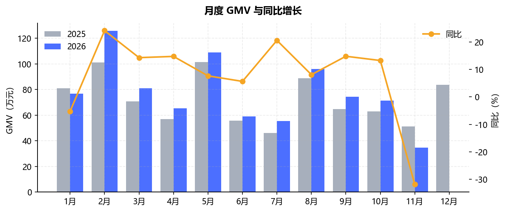
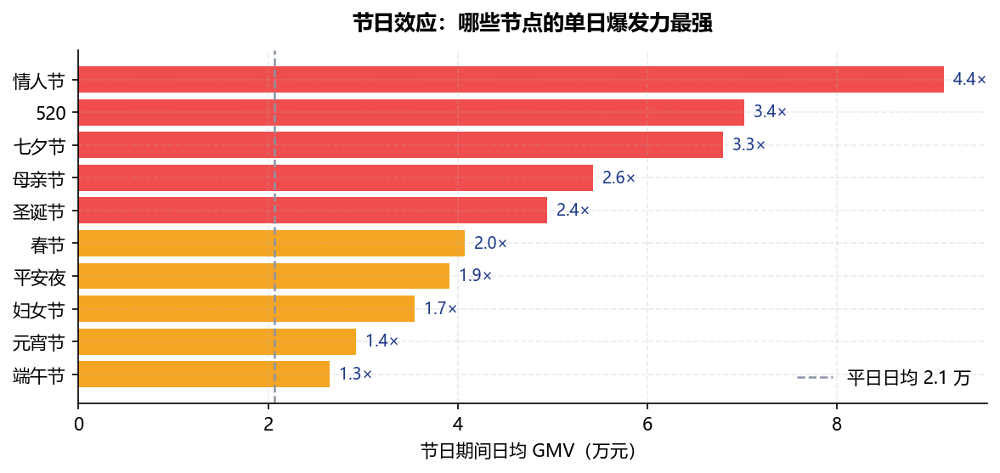
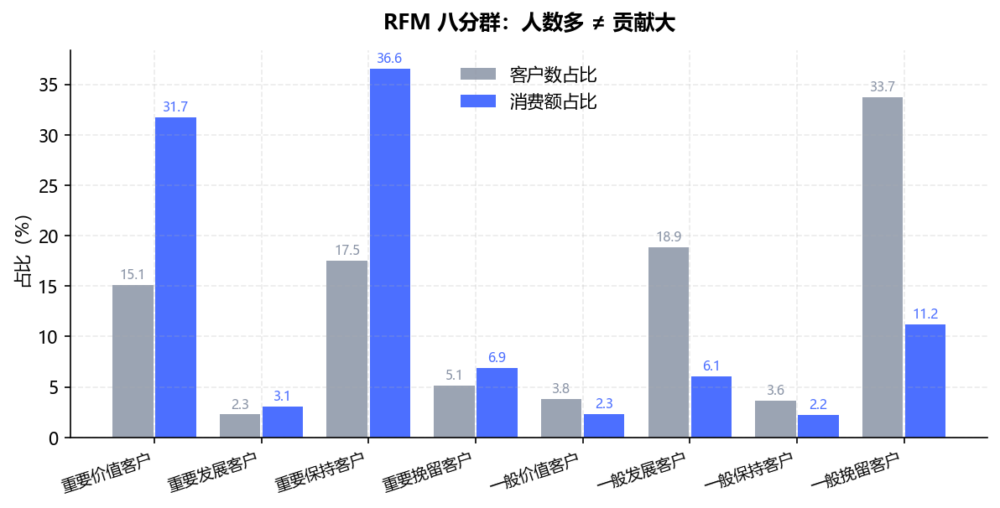
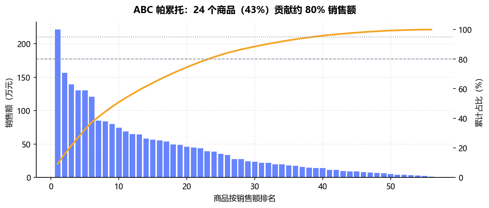
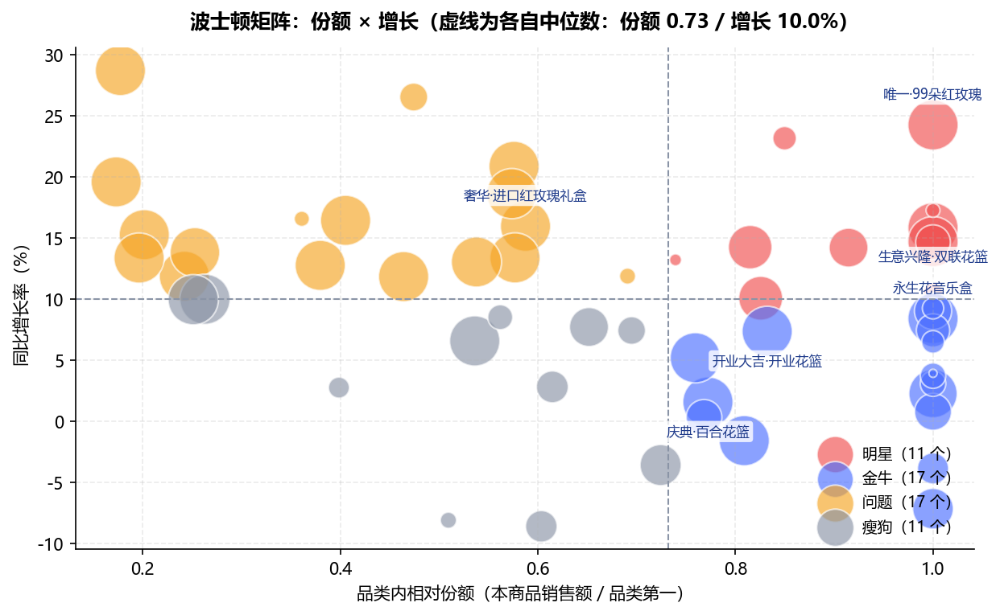
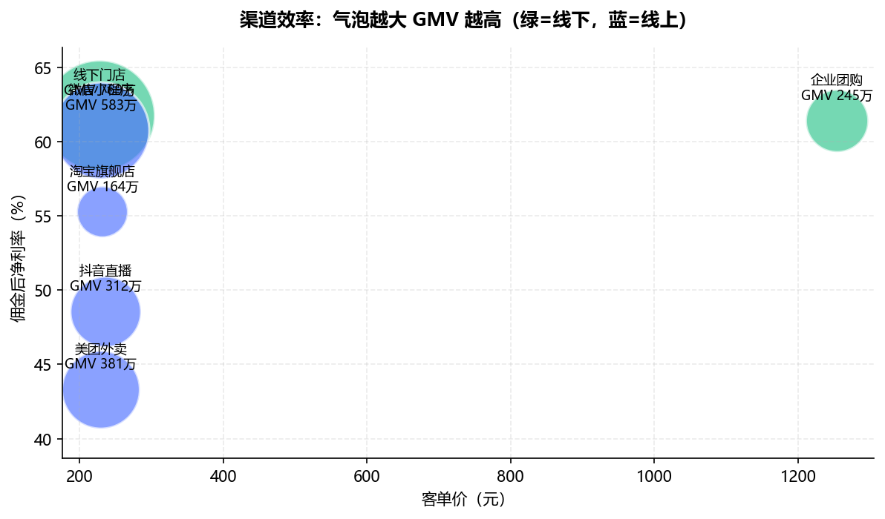
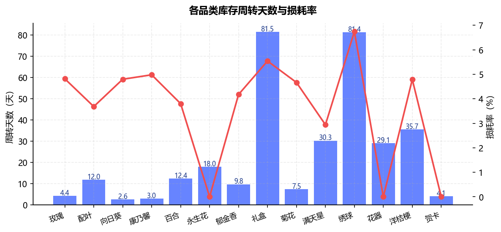
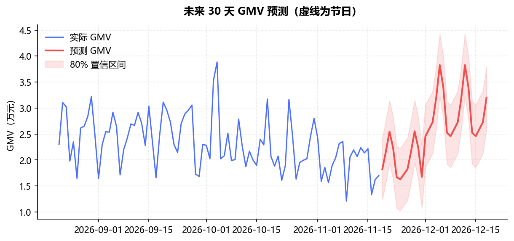

# 花店经营分析报告

> 报告周期：2024-01-01 ~ 2026-11-18｜生成时间：2026-11-21 11:21｜数据口径：剔除已取消订单

## 摘要

**848 万元的年度 GMV（同比 +11.6%）背后，是「量在涨、价没涨」**：订单数贡献了 95% 的增量。核心 33% 的客户贡献 68% 的消费额，而线上渠道虽有 59% 的 GMV 占比，却被平台抽走 118 万佣金。

| 关键指标 | 数值 | 关键指标 | 数值 |
| --- | ---: | --- | ---: |
| 统计期 GMV | 2454.1 万元 | 统计期订单 | 97,933 单 |
| 年度 GMV 同比 | +11.6% | 销量贡献占比 | 95% |
| 核心客户 GMV 占比 | 68.3% | 核心客户人数占比 | 32.6% |
| 线上 GMV 占比 | 58.7% | 平台佣金（3 年） | 117.7 万元 |
| 库存损耗率 | 4.18% | 预测 MAPE | 10.11% |

## 一、经营表现：量增价平

2026 年前 10.5 个月 GMV **848.0 万元，同比 +11.6%**。用「量价拆分」把增长拆开：销量效应 83.9 万元、价格效应 4.1 万元——**增长几乎全部由订单量驱动**。

**这意味着**：门店的获客/复购做得不错，但客单价三年基本没动（250 元左右）。下一步增长要么继续拉新（成本在涨），要么把客单价做上去（组合套餐、高价花材）。

## 二、节日是绝对主场

情人节期间日均 GMV 是平日的 **4.41 倍**，520、七夕、母亲节依次跟上；清明则是「低价高频」的结构性需求。

## 三、用户价值：二八结构清晰

按 RFM 打分后分 8 群：**核心客户（重要价值 + 重要保持）占 32.6%，贡献 68.3% 消费额**；挽留类客户占 38.9%，只贡献 18.1%。RFM 规则分群与 K-Means 聚类的一致性 ARI = 0.235，说明分群不是拍脑袋。

| 分群 | 客户数 | 人数占比 | 消费额占比 | 平均R(天) | 平均F(次) |
| --- | --- | --- | --- | --- | --- |
| 重要保持客户 | 4,951 | 17.5% | 36.6% | 326 | 6.8 |
| 重要价值客户 | 4,275 | 15.1% | 31.7% | 69 | 7.2 |
| 一般挽留客户 | 9,549 | 33.7% | 11.2% | 378 | 1.5 |
| 重要挽留客户 | 1,458 | 5.1% | 6.9% | 400 | 2.1 |
| 一般发展客户 | 5,340 | 18.9% | 6.1% | 71 | 1.4 |
| 重要发展客户 | 640 | 2.3% | 3.1% | 70 | 1.9 |
| 一般价值客户 | 1,070 | 3.8% | 2.3% | 71 | 3.4 |
| 一般保持客户 | 1,028 | 3.6% | 2.2% | 300 | 3.5 |

## 四、商品结构：24 个商品撑起八成销售额

ABC 分类显示 **24 个商品（占 56 个在售商品的 43%）贡献约 80% 销售额**。波士顿矩阵：明星 11 个、金牛 17 个、问题 17 个、瘦狗 11 个。

## 五、渠道：GMV 不等于利润

| 渠道 | 类型 | 订单 | GMV（元） | GMV占比 | 客单价 | 佣金（元） | 佣金后净利率 |
| --- | --- | --- | --- | --- | --- | --- | --- |
| 线下门店 | 线下 | 33,758 | 7,689,201 | 31.3% | 228 | 0 | 61.8% |
| 微信小程序 | 线上 | 25,363 | 5,830,992 | 23.8% | 230 | 34,986 | 60.8% |
| 美团外卖 | 线上 | 16,583 | 3,808,867 | 15.5% | 230 | 685,596 | 43.3% |
| 抖音直播 | 线上 | 13,220 | 3,124,505 | 12.7% | 236 | 374,941 | 48.5% |
| 企业团购 | 线下 | 1,955 | 2,452,256 | 10.0% | 1,254 | 0 | 61.4% |
| 淘宝旗舰店 | 线上 | 7,054 | 1,635,253 | 6.7% | 232 | 81,763 | 55.3% |

佣金后净利率最高的是**线下门店（61.8%）**。线上渠道贡献 58.7% 的 GMV，代价是三年 118 万元佣金。

## 六、促销：让利效率差异巨大

| 活动 | 类型 | 订单 | GMV（元） | 让利（元） | 毛利率 | 让利效率 |
| --- | --- | --- | --- | --- | --- | --- |
| 2025·母亲节全场9.2折 | 折扣 | 432 | 95,827 | 9,360 | 58.7% | 6.0 |
| 2026·母亲节全场9.2折 | 折扣 | 452 | 90,655 | 9,244 | 57.7% | 5.7 |
| 2025·情人节全场8.8折 | 折扣 | 295 | 88,782 | 12,953 | 58.3% | 4.0 |
| 2026·情人节全场8.8折 | 折扣 | 305 | 86,372 | 12,882 | 57.8% | 3.9 |
| 2024·母亲节全场9.2折 | 折扣 | 403 | 83,450 | 8,105 | 57.9% | 6.0 |
| 2026·520全场9.0折 | 折扣 | 241 | 71,231 | 8,868 | 59.0% | 4.7 |
| 2025·圣诞节全场9.0折 | 折扣 | 221 | 70,366 | 8,461 | 59.8% | 5.0 |
| 2024·情人节全场8.8折 | 折扣 | 254 | 69,312 | 10,027 | 57.7% | 4.0 |

> 注：受限于「活动与节日高度共线」，本报告不提供因果意义上的增量 ROI，只给「让利效率」= 活动毛利 / 让利金额。

## 七、库存：绣球是结构性损耗

整体损耗率 **4.18%**。最突出的是**绣球**：周转天数 81.4 天，而货架期只有 6 天——**周转天数 > 货架期，损耗就是必然的**，与员工是否细心无关。

| 品类 | SKU数 | 周转天数 | 损耗率 | 损耗金额（元） |
| --- | --- | --- | --- | --- |
| 玫瑰 | 6 | 4.4 | 4.82% | 108,644 |
| 向日葵 | 1 | 2.6 | 4.80% | 32,835 |
| 康乃馨 | 3 | 3.0 | 4.98% | 32,394 |
| 配叶 | 4 | 12.0 | 3.68% | 26,627 |
| 百合 | 3 | 12.4 | 3.80% | 23,248 |
| 礼盒 | 3 | 81.5 | 5.54% | 18,282 |
| 郁金香 | 3 | 9.8 | 4.18% | 17,900 |
| 绣球 | 3 | 81.4 | 6.74% | 15,538 |

## 八、预测：未来 30 天

SARIMAX（含节假日外生变量）回测 **MAPE 10.11%**，未来 30 天预计 GMV **76.7 万元**，峰值日 2026-12-12 约 38,270 元。

## 九、行动建议（按优先级）

| 优先级 | 建议 | 做什么 | 预期影响 |
| --- | --- | --- | --- |
| P0 | 绣球改「预售 + 按单采购」 | 把 绣球 的备货从「经验」改为「订单驱动」，周转目标压到 ≤6 天 | 该品类损耗可降 30%+，年省 2~3 万 |
| P0 | 把重要保持客户拉回来 | 对 326 天未购、历史高消费的客户发定向唤醒券（限 30 天） | 若召回 10%，可带来约 18 万 GMV |
| P1 | 提客单价而不是提折扣 | 用「花束 + 花瓶/巧克力」套餐替代深折扣，套餐转化率高于打折 | 客单价 +8%~12% |
| P1 | 美团降权、私域升权 | 美团 18% 佣金，把首单客户引导到小程序复购 | 佣金支出 −15% |
| P1 | 瘦狗商品精简 | C 类 17 个商品只贡献 5% 销售额，砍到 40 个 SKU 以内 | 采购复杂度与损耗双降 |
| P2 | 情人节按预测 1.15 倍备货 | 提前 5 天备货，避免节日断货 | 减少缺货损失 |
| P2 | 关联套餐上线 | 加购-花器 → 感恩祝福（提升度 2.55）做成固定套餐 | 搭售率 +3pp |

## 附录：口径与局限

| 项目 | 说明 |
| --- | --- |
| GMV | 实付金额（商品实收 + 运费），剔除已取消订单 |
| 毛利率 | 商品毛利 / GMV，不含履约成本与平台佣金 |
| 节日 | 取自业务日历（农历节日逐年硬编码），含预售期 |
| BCG 横轴 | 品类内相对份额（本商品 / 品类第一），非真实竞品份额 |
| 促销 ROI | 让利效率，非因果增量（无对照组） |
| 预测 | SARIMAX(1,1,1)(1,0,1,7)，外生变量为周末/节假日/节日/需求指数 |

**数据质量**：清洗后 18 条规则得分 99.61（A），与业务库金额对账差额 0.00。
**局限**：全部为模拟数据；不含真实竞品与市场数据；促销效果无法做因果归因。
