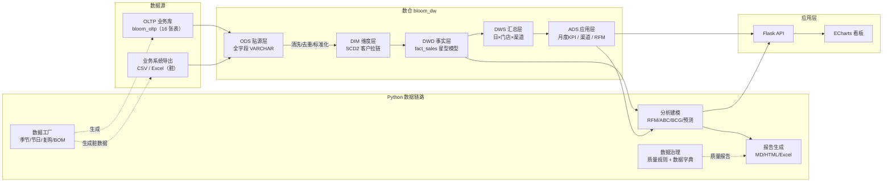

# 🌸 BloomAnalytics · 花店全渠道经营数据分析平台

> 从一家连锁花店的 **10 万单交易数据** 出发，完整走一遍
> **OLTP 业务库 → 分层数仓（ODS/DWD/DWS/ADS）→ 数据治理 → Python 分析建模 → ECharts 交互看板 → 经营分析报告**
> 的数据价值链。


---

## 一、这个项目解决什么问题

花店是典型的 **「强节日驱动 + 生鲜损耗 + 会员复购」** 生意：

- 情人节、520、母亲节、七夕四天的销售额能占全年的 1/4；
- 花材是生鲜，卖不掉就是损耗，库存与销量必须按 **BOM（花束物料清单）** 还原；
- 线上渠道（小程序/美团/抖音）佣金不同，**GMV 高不等于赚钱**；
- 会员复购贡献大部分利润，但"哪些客户值得投钱"没人算得清。

所以这个项目不做"订单增删改查"，而是回答老板真正关心的四个问题：

| 老板的问题 | 项目里的回答 |
| --- | --- |
| 钱从哪来？ | 节日效应拆解、渠道/门店贡献度、品类结构（波士顿矩阵） |
| 赚不赚钱？ | 按 BOM 还原真实成本，扣掉平台佣金后的分层毛利率 |
| 客户值不值钱？ | RFM 用户价值分层 + 生命周期 + 复购/流失 |
| 明天卖多少？ | STL 季节分解 + 节假日因子 + SARIMAX 滚动预测 |

> 项目起点是作者早期的 C++/Qt 花店订单管理系统（`../huadian`），
> 保留了它的业务语义（花束 BOM、节日促销、订单状态流转、配送时效），
> 但把技术栈从"桌面 CRUD"升级为"数据平台"，让同一份业务知识产生分析价值。

---

## 二、数据规模（全部可复现，数字为实测值）

| 对象 | 规模 |
| --- | --- |
| 时间跨度 | 2024-01-01 ~ 2026-11-18（1053 天，含 3 个完整年度的节日周期） |
| 订单 | **101,818 单** |
| 订单明细 | **116,292 行** |
| 客户 | **28,705 人**（个人 + 企业团购），SCD2 拉链后 **32,149** 个版本 |
| 花材 SKU / 花束 | 41 / 38（含 106 条 BOM 关系） |
| 退款单 / 状态流转日志 | 3,862 / 69,052 |
| 每日库存 | 43,173 行 |
| 业务库装载总量 | **371,416 行** |
| ODS 贴源层（脏数据） | **249,468 行** |
| 脏数据注入 | 18 类规则、约 6,000 处问题（用于演示清洗与质量治理） |
| 三年 GMV | **25,533,555.99 元**（事实表与业务库对账差额 **0.00**） |

所有数据由 `bloom.datagen` 用**固定随机种子**生成，同一份配置每次跑出来完全一致，
方便复现、回归测试与写文档引用具体数字。

### 实测验证结果（第 1、2 轮跑通）

```
① 数仓对账：金额 25,533,555.99 = 25,533,555.99  差额 0.00     ✅
   订单数 101,818 = 101,818 ／ 明细 116,292 = 116,292           ✅
   维度孤儿行（日期/客户/商品/门店/渠道）全为 0                  ✅
   SCD2 唯一性：28,705 客户 = 28,705 个当前版本                 ✅

② 清洗对账：业务库 101,818 = 清洗层 100,904 + 隔离 914         ✅
   金额差 227,144.84 = 隔离订单金额 227,144.84（解释差 0.00）    ✅
   下单时间/状态/实付金额 100,904 行逐字段一致                  ✅

③ 数据质量：ODS 98.71 分（B）→ DWD 99.61 分（A）               ✅
   18 条规则 · 5 个维度 · 修复 3,900+ 行 / 隔离 2,781 行        ✅
```

执行耗时：生成 45s ｜ 装载 45s ｜ 建仓 10~22s（优化前 376s）｜ ETL 60s ｜ 治理 30s
→ 从零到"可分析 + 可治理"状态约 **4 分钟**。

---

## 三、整体架构



**分层原则**：ODS 不丢任何数据（脏也原样存），DIM/DWD 保证口径唯一，
DWS 把重复计算下沉，ADS 直接服务报表——前端只查 ADS，不做 JOIN。

---

## 四、核心设计

### 1. 花束 = BOM，成本可还原

一个「99 朵红玫瑰」花束不是一条商品记录，而是
`99 × 玫瑰 + 2 × 尤加利 + 包装 + 人工`。项目里用 `bundle_items` 存 BOM，
库存消耗、真实毛利、滞销分析都从 BOM 展开——这是"花店系统"和"零售系统"的关键差异。

### 2. 业务日历驱动的数据真实性

`dim_date` 不只有年月日，还刻了 **农历节日（逐年年份不同）+ 法定假期 + 预售节奏 + 需求指数**：
情人节前 3 天开始升温、春节当天门店冷清、清明卖白菊、毕业季持续半个月。
季节分解和预测模型直接吃这张表，精度和可解释性都靠它。

### 3. 脏数据是设计出来的，不是意外

`raw_export/` 层刻意注入了 17 类质量问题（重复行、负数金额、`已完成 ` 带空格、
`1999-01-01`、手机号含字母、孤立明细行……），
对应 **DQ01~DQ17 规则编号**，与数据质量报告一一对应。
清洗不是"删掉异常"，而是**先量化、再处理、最后对账**。

### 4. 对账思维

数仓最怕"跑得出来但数字不对"。项目内置 8 项校验：
业务库与事实表**金额对账**、订单数对账、维度完整性（孤儿行必须为 0）、
SCD2 版本唯一性、数据新鲜度……差额不为 0 就直接判失败。

### 5. SCD2 拉链

客户会员等级会变，历史订单必须按"下单当时"的等级计算权益。
`dim_customer` 用 `valid_from / valid_to / is_current / version` 实现拉链表，
事实表通过代理键关联历史版本。

### 6. 数据治理：规则可执行、分数可下钻

18 条质量规则（DQ01–DQ18）用"条件表达式"定义，在 ODS 与 DWD 两层各跑一遍，
同一套规则前后对比才能证明清洗有效：**98.71 分 → 99.61 分**。

关键是**不把分数洗到 100**：客户 ID 缺失只能置 UNKNOWN 占位、
已完成单缺配送时间是事实缺失不能编造——这两类保留并打标，
在分析口径里排除，而不是伪造数据。

配套资产全部由代码生成（不是手工 Excel）：
- **数据字典**：527 个字段，从 `information_schema` 实时读取，与库永远一致；
- **指标体系**：48 个指标分原子/派生/复合三层，每个指标绑定唯一一段 SQL；
- **标签体系**：18 个标签，有目录（`dim_tag`）、有值域、有覆盖率监控。

### 7. 清洗对账：一行没丢、一分没多

ODS 103,039 行脏数据 → 去重 → 隔离坏值 → DWD 100,904 单。
对账结果：

```
业务库 101,818 = 清洗层 100,904 + 隔离 914        ✅
金额差 227,144.84 = 隔离订单金额 227,144.84       ✅（解释差 0.00）
下单时间/状态/实付金额 100,904 行逐字段 100% 一致  ✅
```

> 数仓最容易出的问题不是报错，而是**悄悄少了 1 万行还没人发现**。

---

## 五、目录结构

```
最新项目/
├── 00_核心代码_20261120/        # Python 工程代码（bloom 包）+ 前端资源
│   └── bloom/
│       ├── config.py            # 路径/连接/生成参数统一配置
│       ├── db.py                # MySQL 访问层（批量装载、契约校验、DataFrame 读取）
│       ├── datagen/             # 数据工厂：日历/商品/客户/订单/脏数据
│       ├── pipeline/            # 装载、维度构建、数仓构建、校验
│       ├── governance/          # 治理：质量规则/数据字典/指标/标签/报告渲染
│       └── etl/                 # ODS→DWD 清洗、对账、特征工程
├── 01_项目总览与索引_20261120/   # 目录索引、亮点、架构图
├── 02_方案设计_20261120/        # 需求、ER 图、数仓分层设计、技术选型
├── 03_数据工厂_20261120/        # 模拟数据（clean / raw_export / sample）
├── 04_MySQL数仓_20261120/       # 建库建表、索引视图、存储过程、建仓、对账、性能优化记录
├── 05_数据治理_20261120/        # 质量报告(MD/HTML/JSON)、数据字典、指标体系、标签体系
├── 06_ETL与特征工程_20261120/   # DWD 清洗层建表、清洗规则、对账报告、特征表与特征字典
├── 07_分析与建模_20261121/      # 8 个分析模块、9 份报告、14 张图、5 张结果表
├── 08_可视化看板_20261121/       # 看板说明、API 文档、使用手册、一键启动
├── 09_经营分析报告_20261121/     # 自动生成的经营分析报告（MD / HTML / Excel）
├── 10_BI工具配套_20261121/       # Tableau 手册、Power BI 度量值、R 脚本、11 个 CSV
├── 11_测试_20261121/            # 73 个 pytest 用例
├── 12_文档与简历_20261121/       # 简历条目、面试问答、演示脚本、复盘、GitHub 指南
├── run.py                      # 命令行入口（gen/load/dw/check/etl/gov/analysis/dashboard/report）
├── requirements.txt
└── .env.example
```

> 每个目录都带 **序号 + 名称 + 日期**，按数据流顺序编号，便于逐轮对照阅读。
> 每个目录下的 `00_说明.md` 是本轮的"导读"，建议从那里开始看。

---

## 六、快速开始

### 环境要求

- Windows / macOS / Linux
- Python 3.9+
- MySQL 8.0+（本地已启动，需知道 root 密码用于初始化）

### 四步跑通

```bash
# 0) 安装依赖（自动创建 .venv，走阿里云镜像）
双击 00_安装依赖.bat

# 1) 初始化数据库：建库 + 建专用账号 + 建表 + 索引 + 存储过程
双击 04_MySQL数仓_20261120\00_一键初始化数据库.bat
（会提示输入一次 MySQL root 密码；应用账号密码随机生成，只写入 .env）

# 2) 生成 3 年模拟数据（约 10 万订单）
双击 03_数据工厂_20261120\01_generate_data.bat

# 3) 装载业务库 + 构建数仓 + 对账
双击 04_MySQL数仓_20261120\10_load_data.bat
双击 04_MySQL数仓_20261120\11_build_dw.bat
双击 04_MySQL数仓_20261120\12_validate.bat
```

也可以纯命令行：

```bash
python run.py gen      # 生成数据
python run.py load     # 装载业务库 + ODS
python run.py dw       # 建维度 + 建事实 + 建 ADS
python run.py check    # 8 项对账校验
python run.py all      # 一把梭
```

### 第 2 轮：数据治理与 ETL（在第 1 轮跑完之后）

```bash
python run.py etl      # ODS→DWD 清洗 + 对账 + 三张特征表
python run.py gov      # 质量报告 / 数据字典 / 指标体系 / 标签体系
# 或者一条命令
python run.py round2
```

跑完看这几个文件：

| 文件 | 里面是什么 |
| --- | --- |
| `05_数据治理_20261120/03_数据质量报告.html` | 带图表的治理报告（浏览器打开） |
| `05_数据治理_20261120/07_指标体系.md` | 48 个指标的口径与当前值 |
| `06_ETL与特征工程_20261120/03_对账报告.md` | 清洗层 vs 业务库的逐项对账 |

### 第 3 轮：分析建模（在第 2 轮跑完之后）

```bash
python run.py analysis     # 8 个分析模块，约 15 秒
```

跑完看这几个文件：

| 文件 | 里面是什么 |
| --- | --- |
| `07_分析与建模_20261121/02_经营总览与趋势分析.md` | 同比增长与量价拆分 |
| `07_分析与建模_20261121/03_RFM用户价值分析.md` | 8 分群 + K-Means 校验 + CLV |
| `07_分析与建模_20261121/04_商品结构与波士顿矩阵.md` | ABC 帕累托 + BCG 四象限 |
| `07_分析与建模_20261121/09_销售预测.md` | STL 分解 + SARIMAX 30 天预测 |
| `07_分析与建模_20261121/charts/` | 14 张图表（可直接插 PPT） |

### 第 4 轮：交互式看板

```bash
python run.py dashboard --port 5050
# 浏览器打开 http://127.0.0.1:5050
# 或直接双击 08_可视化看板_20261121\90_run_dashboard.bat
```

6 个页面 / 14 张图表：

| 页面 | 图表 |
| --- | --- |
| 经营总览 | KPI×6、月度 GMV+同比、渠道环图、节日效应、门店 GMV |
| 用户价值 | 八分群对比、R-F 散点（点大小=消费额）、分群明细 |
| 商品结构 | ABC 帕累托、波士顿矩阵气泡、TOP20 明细 |
| 促销与渠道 | 活动让利效率、折扣敏感度、渠道效率气泡、渠道明细 |
| 库存损耗 | 品类周转+损耗双轴、滞销 TOP10 |
| 销售预测 | 90 天历史 + 30 天预测（含置信区间）、明细表 |

### 第 5 轮：报告 / BI 配套 / 测试

```bash
python run.py report                     # 生成经营分析报告 + 导出 11 个 BI CSV
python -m pytest 11_测试_20261121 -q      # 73 个用例（无数据库时自动跳过部分）
```

| 产物 | 位置 |
| --- | --- |
| 经营分析报告（MD / HTML / Excel） | `09_经营分析报告_20261121/` |
| Tableau 手册 / Power BI DAX / R 脚本 / CSV | `10_BI工具配套_20261121/` |
| 简历条目 / 面试问答 / 演示脚本 | `12_文档与简历_20261121/` |

### 跑完你能看到什么

```sql
-- 月度经营 KPI（ADS 层，可直接喂看板）
SELECT * FROM bloom_dw.ads_kpi_monthly ORDER BY month_key DESC LIMIT 12;

-- 节日效应：情人节当天销售额是平日的多少倍？
SELECT d.festival_name, ROUND(AVG(v.gmv)) AS 日均GMV
FROM bloom_dw.v_daily_kpi v
JOIN bloom_dw.dim_date d ON d.full_date = v.full_date
WHERE d.is_festival = 1
GROUP BY d.festival_name
ORDER BY 日均GMV DESC;
```

---

## 七、技术栈

| 层次 | 技术选型 | 说明 |
| --- | --- | --- |
| 交易库 | MySQL 8.0 · InnoDB · utf8mb4 | 第三范式、外键约束、DECIMAL 金额 |
| 数仓 | MySQL 分层建模 | ODS/DIM/DWD/DWS/ADS、星型模型、SCD2、分区表 |
| SQL 工程 | 视图 / 存储过程 / 自定义函数 | 口径函数化、批处理幂等 |
| 数据处理 | Python 3.9 · pandas · NumPy | 数据工厂、清洗、特征工程 |
| 分析建模 | statsmodels · scikit-learn · SciPy | STL 分解、SARIMAX、K-Means、假设检验 |
| 可视化 | matplotlib · seaborn · ECharts | 静态图表 + 交互式看板 |
| Web | Flask + 原生 HTML/CSS/JS | 零构建、离线可用 |
| 报表 | openpyxl · XlsxWriter | 多 Sheet 经营分析 Excel |

---

## 八、第 3 轮的关键业务结论

| 问题 | 数据给出的答案 |
| --- | --- |
| 生意在变好吗？ | 2026 年前 10.5 个月 GMV **848 万，同比 +11.6%**；增长 **95% 来自订单量**，客单价几乎没涨（+0.5%） |
| 什么时候最赚钱？ | 情人节日均 GMV 是平日的 **4.41 倍**，520 是 3.4 倍，七夕 3.3 倍；全年前十大节日贡献约 **1/4** 的 GMV |
| 谁最值钱？ | **32.6% 的核心客户（重要价值 + 重要保持）贡献 68.3% 的消费额**；38.9% 的挽留类客户只贡献 18.1%，适合低成本触达 |
| 卖什么最赚？ | **24 个商品（43%）贡献 80% 销售额**；BCG 象限为 明星 11 / 金牛 17 / 问题 17 / 瘦狗 11 |
| 促销有用吗？ | 活动订单毛利率比非活动低 **2.23pp**，但深折扣并未带来订单量提升；最高让利效率 11.69 元毛利/元让利 |
| 哪个渠道真赚钱？ | 线上占 **58.7% GMV**，却被平台抽走 **117.7 万佣金**；线下门店净利率 61.76% 最高 |
| 损耗从哪来？ | 整体损耗率 **4.18%（30.2 万元）**；绣球周转 **81.4 天** vs 货架期 6 天 = **13.6 倍**，属结构性损耗 |
| 还能搭什么卖？ | 「加购-花器 → 感恩祝福」提升度 **2.55**；13,436 个多件订单里挖出 31 条可落地规则 |
| 明天备多少货？ | SARIMAX 回测 **MAPE 10.11%**，未来 30 天预计 **76.65 万**，峰值日可提前 5 天加量 |

> 完整推导见 `07_分析与建模_20261121/` 下的 9 份报告，每份都包含方法、图表、口径边界与运营建议。

---

## 九、进度与路线图

| 轮次 | 内容 | 状态 |
| --- | --- | --- |
| **第 1 轮** | 项目骨架、数据工厂（10.18 万单 + 18 类脏数据）、MySQL 双层库、分层建表、索引视图存储过程、装载 37 万行、8 项对账全绿、建仓性能优化 376s→10s | ✅ **已完成并验证** |
| **第 2 轮** | 数据治理：18 条质量规则 + 五维评分（98.71→99.61）、527 字段数据字典、48 个指标体系、18 个标签体系；ETL 清洗链路（修复 3,900+ / 隔离 2,781 行）+ 全量对账 + 3 张特征表 | ✅ **已完成并验证** |
| **第 3 轮** | 分析建模 8 个模块：经营总览（量价拆分/节日效应）、RFM 8 分群 + K-Means、ABC + 波士顿矩阵、促销让利效率、渠道佣金后净利、库存周转/货架期、自实现 Apriori、SARIMAX 预测（MAPE 10.11%）；14 张图 + 9 份报告 + 7 张结果表 | ✅ **已完成并验证** |
| **第 4 轮** | 交互式看板：Flask 9 个 API + ECharts 6 页 14 图（深色主题、筛选联动、离线资源、5 分钟缓存），首屏 1.8s、其余接口 60~370ms | ✅ **已完成并验证** |
| **第 5 轮** | 经营分析报告一键生成（MD 7.3KB / HTML 876KB 内嵌图表 / Excel 6 Sheet）、BI 三件套（Tableau 手册 + Power BI 20 个 DAX + R 脚本 + 11 个 CSV）、73 个 pytest 用例、简历与面试材料 | ✅ **已完成并验证** |

> 第 1 轮的真实调试过程记录在 [`04_MySQL数仓_20261120/20_性能优化记录.md`](04_MySQL数仓_20261120/20_性能优化记录.md)：
> 建表撞 MySQL 保留字、跨库视图没写库名、维表缺索引导致建仓慢 38 倍——
> 三个坑都有完整的原因分析与修复验证，也是面试时最好的素材。

---

## 十、引用与许可

- **作者**：数据科学与大数据技术专业 · 个人项目
- **License**：[MIT](LICENSE)
- **引用元数据**：[`CITATION.cff`](CITATION.cff)（GitHub 右上角会显示「Cite this repository」）
- **版本记录**：[`CHANGELOG.md`](CHANGELOG.md)
- **归档元数据**：[`.zenodo.json`](.zenodo.json)

### 如何引用

```bibtex
@software{bloomanalytics2026,
  title   = {BloomAnalytics: 花店全渠道经营数据分析平台},
  author  = {Jirui Huang},
  year    = {2026},
  version = {1.0.0},
  license = {MIT},
  url     = {https://github.com/HJR-tjdrz/bloom-analytics}
}
```

> **Zenodo DOI**：首次发布 Release 后自动生成。
> 拿到后在这里加一行徽章即可（步骤见 [发布与归档指南](12_文档与简历_20261121/05_发布与归档指南.md)）：
>
> ```markdown
> [](https://doi.org/10.5281/zenodo.XXXXXXX)
> ```

> 数据全部为程序生成的模拟数据，不含任何真实客户信息，可安全公开。
